---

> **译者注：** 本文翻译自 Aleksa Gordić 的技术博客文章。原文链接：[https://www.aleksagordic.com/blog/collective-operations](https://www.aleksagordic.com/blog/collective-operations)
>
> 这是一篇深入讲解 TPU 与 GPU 集群拓扑、以及 Transformer 训练与推理中所依赖的核心集合通信算子（All-Gather、Reduce-Scatter、All-Reduce、All-to-All）的技术文章。翻译过程中已尽力保持原文的技术准确性与可读性，如有疏漏之处，欢迎指正。

---

## 深入 All-Gather、Reduce-Scatter、All-Reduce 与 All-to-All，覆盖 TPU 与 GPU 集群

`2026 年 7 月 14 日`

在本文中，我将深入剖析 TPU 和 GPU 集群的拓扑结构，并讲解 Transformer 训练与推理过程中所依赖的核心集合通信算子。

我们为什么要关心这些？

到了 2026 年，Transformer 的训练与在线推理（serving）已经是一个典型的大规模分布式系统问题。

要把模型切分（shard）到整个集群上，我们需要依赖**数据并行**（data parallelism）、**张量/模型并行**（tensor/model parallelism）、**FSDP** 以及**专家并行**（expert parallelism）这类技术。而在底层，这些技术都构建在少数几个核心的集合通信算子之上：

1. 数据并行训练需要在反向传播过程中进行梯度同步，这通常通过 **all-reduce**（全规约）来实现。后文我们会看到，all-reduce 本身又可以分解为先 **reduce-scatter**（规约-分散）再 **all-gather**（全收集）。
2. 张量并行与 FSDP 在前向传播和反向传播中都大量依赖 **all-gather** 和 **reduce-scatter**。
3. MoE（Mixture-of-Experts，专家混合）模型中采用的专家并行，则依赖 **all-to-all**（全交换）这个原语（primitive）。

这些只是几个比较重要的例子，但已足以说明理解集合通信的价值所在——如果你想分析现代 Transformer 系统的性能，最终就绕不开数据在集群中究竟是如何流动的。

我们先从硬件入手，也就是 TPU 和 GPU 的集群拓扑。理解了集群的物理布局之后，这些集合通信算法会变得更有根基，也更容易分析。

在此基础上，我们再深入探讨这些核心集合通信算子最常见的实现方式。

我会把重点放在环式（ring）算法上，因为它们是处理大消息通信时最自然的起点。

而对于较小的数据量，延迟开始占据主导地位，此时树式（tree）算法会是更合适的选择（因为它们只需要 `log2` 步）。

本文分为七个部分：

1. [TPU 集群拓扑](https://www.aleksagordic.com/blog/collective-operations#cpt1)：Superpod、Slice、DCN、PCIe、ICI
2. [深入 All-Gather](https://www.aleksagordic.com/blog/collective-operations#cpt2)：1D/2D 环与链
3. [Reduce-Scatter（及 All-Reduce）](https://www.aleksagordic.com/blog/collective-operations#cpt3)：All-Gather 的对偶
4. [All-to-All](https://www.aleksagordic.com/blog/collective-operations#cpt4)：分片式转置
5. [NVIDIA GPU 集群拓扑](https://www.aleksagordic.com/blog/collective-operations#cpt5)：节点、可扩展单元（Scalable Unit）与胖树（Fat Tree）
6. [节点内 GPU 集合通信](https://www.aleksagordic.com/blog/collective-operations#cpt6)：环、树与 SHARP
7. [跨节点 GPU 集合通信](https://www.aleksagordic.com/blog/collective-operations#cpt7)：基于 InfiniBand 的分层算法

## TPU 集群拓扑

我先从 TPU 讲起，因为它的拓扑比 GPU 集群拓扑更加规整，因此某种意义上也更容易分析。

TPU 与 GPU 集群之间的关键区别在于**最近邻连接**（nearest-neighbor connectivity）。TPU 芯片直接与相邻的 TPU 芯片相连，而每颗芯片拥有 **4 个还是 6 个最近邻**，取决于 TPU 的代际：

1. TPU `v2`、`v3`、`v5e` 与 `v6e` 采用 2D 环面（torus）拓扑，拥有 4 个最近邻。
2. TPU `v4p`、`v5p`、`TPU7x`（Ironwood）与 `8t` 采用 3D 环面拓扑，拥有 6 个最近邻。

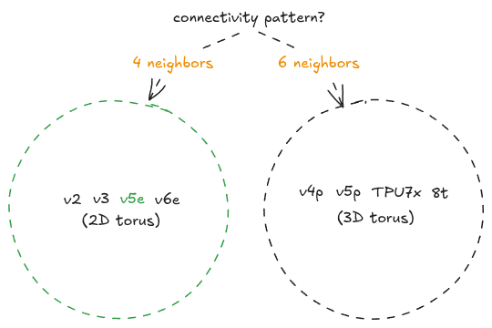

<em>图 1：TPU 连接类别</em>

> 值得注意的是，谷歌的[新一代推理 TPU 芯片](https://cloud.google.com/blog/products/compute/tpu-8t-and-tpu-8i-technical-deep-dive) [1] `8i` 偏离了 2D/3D 环面，转而采用 boardfly——一种分层的高基数（high-radix）拓扑。本文会忽略它。

下面是我建立对「4 最近邻、2D 环面」这种结构直觉的一种方式。2D 环面可以表示成一个带有环绕（wraparound）/周期性边界的网格：从左边缘移出去，会从右边缘绕回来（反之亦然）；从上边缘移出去，会从下边缘绕回来（反之亦然）。请记住，TPU 环面是一个离散的网格，你可以把它想象成铺在这个甜甜圈表面上的网格。下面的可视化只是为了建立直觉：

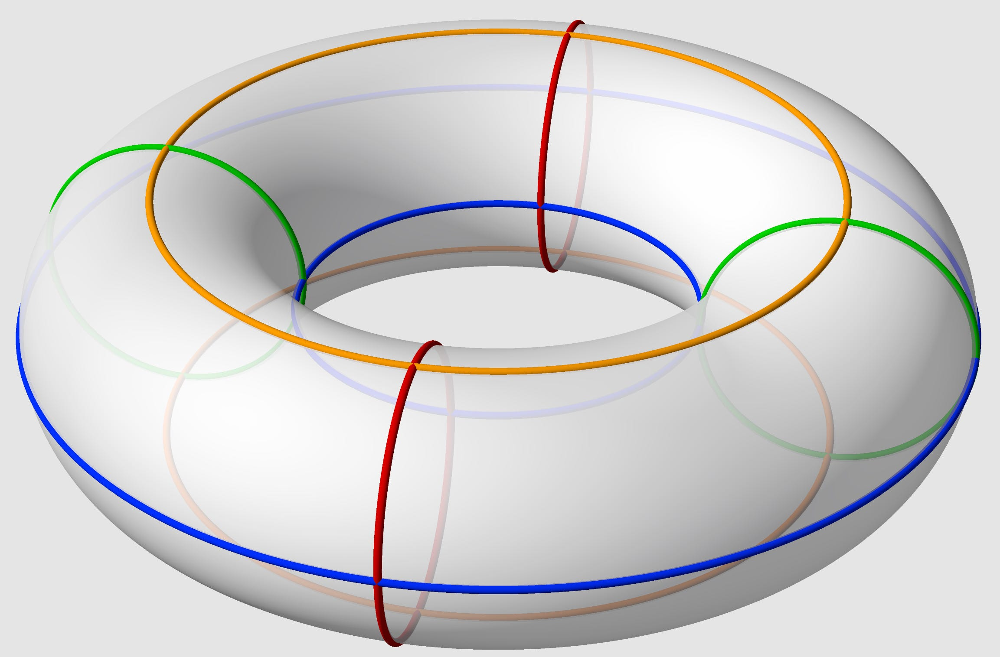

<em>图 2：2D 环面的直觉：一个带有环绕边界的网格</em>

类似地，下面是 6 最近邻、3D 环面的连接模式：

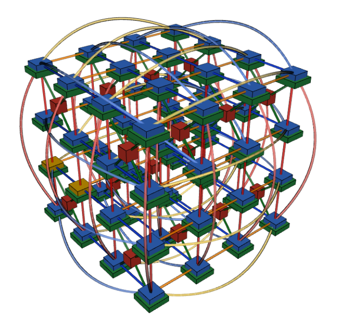

<em>图 3：3D 环面连接</em>

这张图看起来有点乱，但背后的道理很简单——每颗芯片在 ±x、±y、±z 三个方向上都有邻居，而且边缘会在所有三个维度上环绕回来。

> 这里有一个小巧好用的[可视化工具](https://tpu-visualizer.uc.r.appspot.com/) [2]，我用它生成了上面那张图。你也可以用它来交互式地探索这些更复杂的拓扑。

本文中，我会以 `v5e` 作为贯穿全文的例子，因为 2D 连接更容易可视化。

TPU 芯片通过 **ICI**（inter-chip interconnect，芯片间互连）与邻居通信。

由 ICI 连接起来的最大一块 TPU「孤岛」被称为 **TPU Pod**。有时你也会听到人们把它叫作 **superpod**；本文中我会把这两个词混用。

例如，一个 `v4` Pod 包含 16 × 16 × 16 颗芯片，共计 4096 颗 TPU；而一个 `v5p` Pod 包含 16 × 20 × 28 颗芯片，也就是 8960 颗 TPU！

> 对比一下 GPU：GPU 的 scale-up 域（纵向扩展域）传统上要小得多——通常一个 NVLink 域内有 8 颗 GPU，而最近 NVIDIA 的 GB200 NVL72 把这一数字提高到了 72 颗。稍后我们会更深入地分析 GPU。

对于芯片拥有 6 个最近邻的 TPU Pod 而言，最小的完整 3D 环面是一个 4×4×4 的立方体。如果你申请更小的拓扑，例如 2×2×2，就会失去环绕连接，于是这个 slice（切片）就不再是环面，而退化成网格（mesh）。

> TPU slice 是单个 TPU Pod 内通过 ICI 连接起来的一组芯片（一个「ICI 孤岛」）。对 `v5e` 来说，可以是 2×2、2×4、8×8 等等。最大的 slice 就是 (super)pod 本身。

正如我们稍后会看到的，这会使得沿着那个轴的环式集合通信时间大约翻倍。所以这一点值得注意——如果你的应用是通信密集型的，你可能希望申请能保留环面结构的 slice 形状，例如 4×4×8。

另一方面，`v5e` 拥有 16×16 的 2D 环面 Pod。环绕连接在尺寸为 16 时才存在，所以如果你取一个更小的 slice，比如 8×16，就会在较短的那个轴上失去环绕（同样地，沿着该轴的集合通信算子大约要付出 2× 的代价）。

要想扩展到单个 Pod 之外，TPU 会使用 **DCN**（data center networking，数据中心网络）。DCN 的吞吐量比 ICI 低得多，所以你必须小心：如果有太多通信跨越 Pod 边界，它就很容易成为训练中的瓶颈。

把以上这些都放到一起，我们来看看一个 16×16 `v5e` Pod 的拓扑结构。花点时间分析一下这张图（必要时可以放大）：

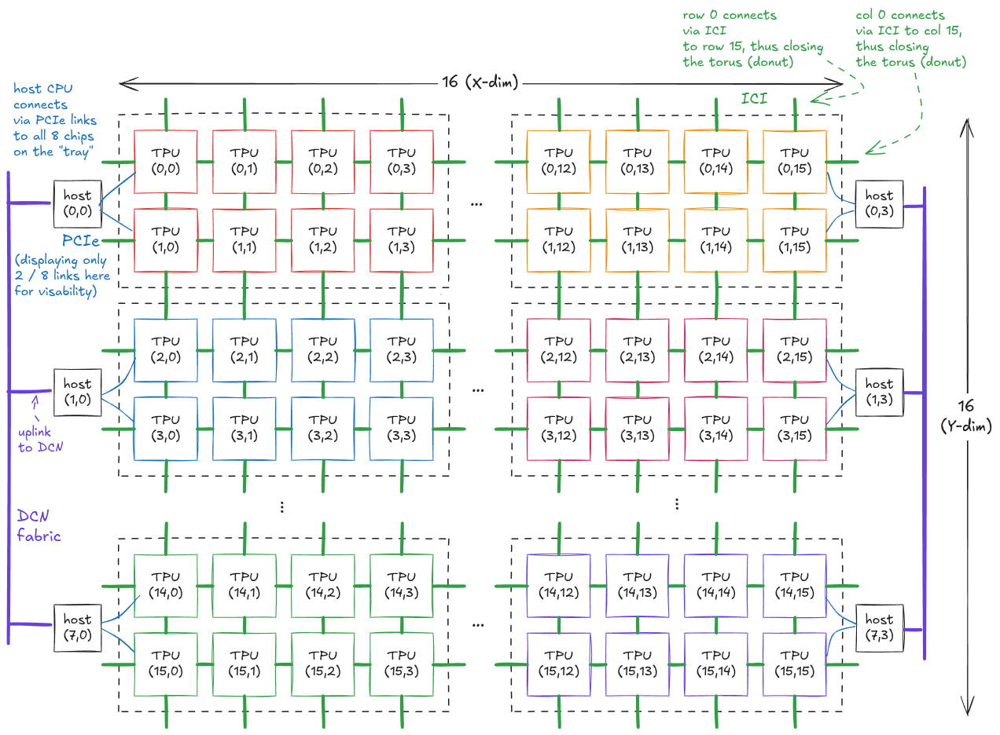

<em>图 4：v5e TPU 16×16 superpod 的拓扑</em>

我们可以通过共享的 DCN 网络（fabric）把多个 Pod 连成更大的计算集群（也许这才该叫 superpod，哈哈）：

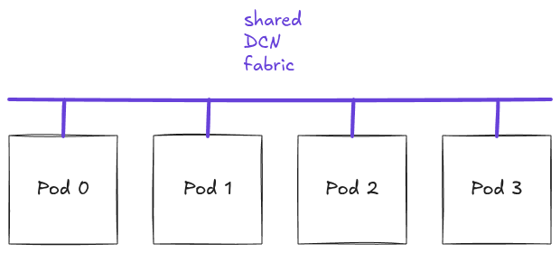

<em>图 5：通过 DCN 骨干网连接起来的多个 Pod</em>

还有几个细节值得了解。

从上图可以看出，在 Pod 内部，第 0 行会连回第 15 行，第 0 列会连回第 15 列。正是这一点让拓扑成为环面/甜甜圈，而不是普通的网格。环面的几何结构限制了路径长度，因为数据从源芯片到达目标芯片，往往需要流经中间的 TPU。

例如，如果 TPU `(15, 15)` 想给 TPU `(2, 15)` 发送数据，最短路径会走环绕连接：

`(15, 15)` → `(0, 15)` → `(1, 15)` → `(2, 15)`

而不是绕远路，依次经过 `(14, 15)`、`(13, 15)` 等等。

> TPU 还支持「扭曲环面」（twisted torus）配置，它会改变环绕连接方式，以减少 All-to-All 等通信模式下的跳数（hop count）。这是一个能提升效率的实现细节，但就本文的目的而言，我们无需了解它。

每颗 TPU 芯片还会通过 **PCIe** 连接到一个「专属」的 CPU 主机（host）。以 `v5e` 为例，一台主机连接一个 2×4 的 TPU 芯片块，因此主机与这 8 颗芯片之间有 8 条 PCIe 连接。

重要的是要注意：数据要到达 DCN 骨干网，必须先经过 PCIe，这意味着 DCN 通信甚至比 PCIe 还要慢。

具体来说，跨 Pod 的数据会从源 TPU 芯片的 HBM 出发，经 PCIe 到达源主机，再通过 DCN 网络流出，进入目标主机，最后再经 PCIe 回到目标 TPU 芯片的 HBM。

这就自然而然地形成了一个**带宽层级**（bandwidth hierarchy）。离 TPU 芯片上的计算核心（compute die）越近，数据搬移就越快；越往外走向集群，速度就越慢。

我们把 `v5e` 集群的相关带宽放到同一张图里：

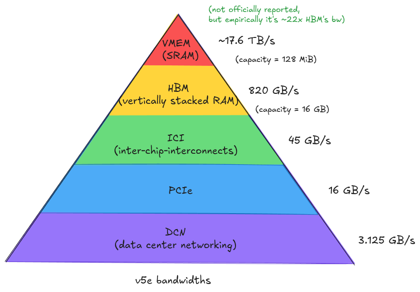

<em>图 6：v5e TPU 集群中的带宽层级</em>

现在，在了解了拓扑与带宽层级之后，我们来看几个具体的例子，看看数据究竟是如何在 TPU slice 中流动的。

> 本文中的几个例子，以及这篇博客更广泛的写作动机，都受到了出色的 Scaling Book [3] 的启发，我强烈推荐这本书。

假设我们从 GCP 申请了一个 4×4 的 `v5e` slice。由于两个轴都小于 16，我们得不到任何环绕连接。所以这个 slice 不是环面，而是一个普通的 2D 网格，芯片之间的一些路径会比有环绕连接时更长。

我们提出下面这个问题：把一个 `(2048, 2048)` 的 `bf16` 矩阵从 TPU 芯片 `(3, 3)` 搬到 TPU 芯片 `(0, 0)` 需要多长时间？

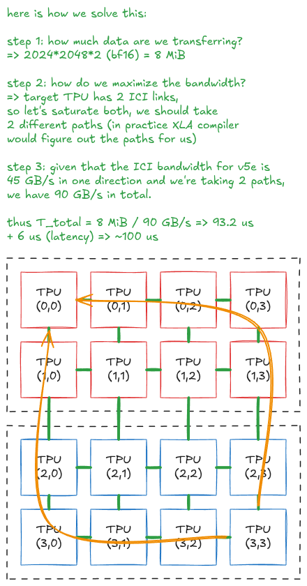

<em>图 7：用两条 ICI 路径在 4×4 v5e 网格上搬移一个 8 MiB 的 bf16 矩阵</em>

请注意，上面的计算忽略了链路延迟。实际上，ICI 链路每跳（hop）大约有 1 μs 的延迟。

在我们的例子中，每条路径长 6 跳。由于两条路径并行执行，这会为传输额外增加大约 6 μs 的延迟，在这里可以忽略不计，但对于较小的消息来说，这也许就不能忽略了。

这就是为什么理解我们处于**延迟受限**（latency-bound）还是**吞吐受限**（throughput-bound）的状态很重要。

一个简单的估算方法是问：假设我们跑满了 45 GB/s 的单向 ICI 带宽，那么 1 μs 内一条链路能流过多少数据？

答案是：

45 GB/s × 1 μs = 45 KB

所以如果我们的消息块差不多是这个大小，延迟就非常重要。忽略每跳 1 μs 的延迟，可能会让估算产生很大的偏差，因此只考虑带宽的简单近似就不再成立了。

我们再看一个例子，这一次还会用到 PCIe、ICI 以及 HBM → VMEM 链路。

> VMEM 是快速的片上 SRAM，大致相当于 GPU 上由程序员管理的共享内存（shared memory）。它直接向 matmul 单元——对 TPU 芯片而言即脉动阵列（systolic array）——供数。TPU 芯片的内部细节对理解本文的主题并不重要，所以这里我们不再在 VMEM 上多花篇幅。

假设我们有一个 (`128 * 1024`, `128 * 1024`) 的 bf16 矩阵，被切分（shard）在一个 4 × 4 的 TPU slice 上。因此每颗芯片持有一个 (`32 * 1024`, `32 * 1024`) 的子矩阵（128/4=32）。

再假设这些子矩阵已经被卸载（offload）到了主机 DRAM。

把所有这些数据都搬到 TPU `(0, 0)`，并与一个 (`128 * 1024`, `128`) 的 bf16 矩阵做 matmul，需要多长时间？

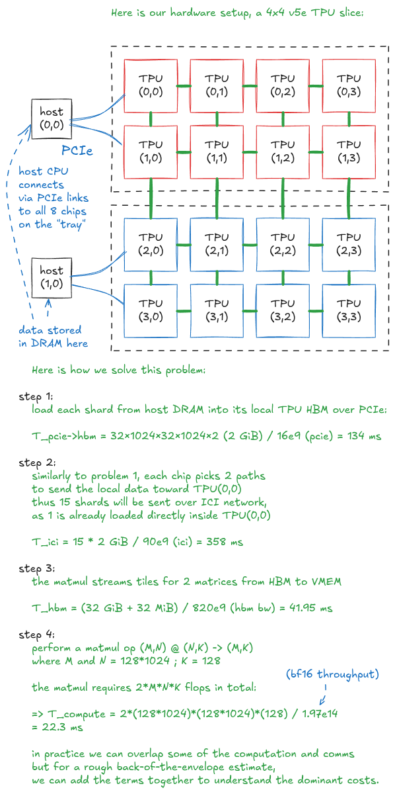

<em>图 8：把切分后的矩阵汇总到 TPU(0,0) 上以做 matmul</em>

在理解了 TPU 拓扑和带宽层级之后，我们就可以进入集合通信算子了。

我们先从 All-Gather 开始。

## 深入 All-Gather：1D/2D 环与链

先从一个引子（motivating example）讲起。

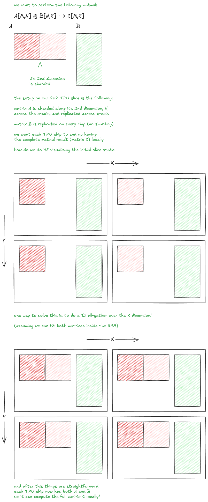

<em>图 9：All-Gather 的动机——把 A 的各分片收集起来，好让每颗芯片都能在本地做 matmul</em>

那么我们该如何高效地实现 All-Gather 呢？

一种常见做法是使用环算法。在看算法本身之前，我们先理解一下这个「环」从何而来：

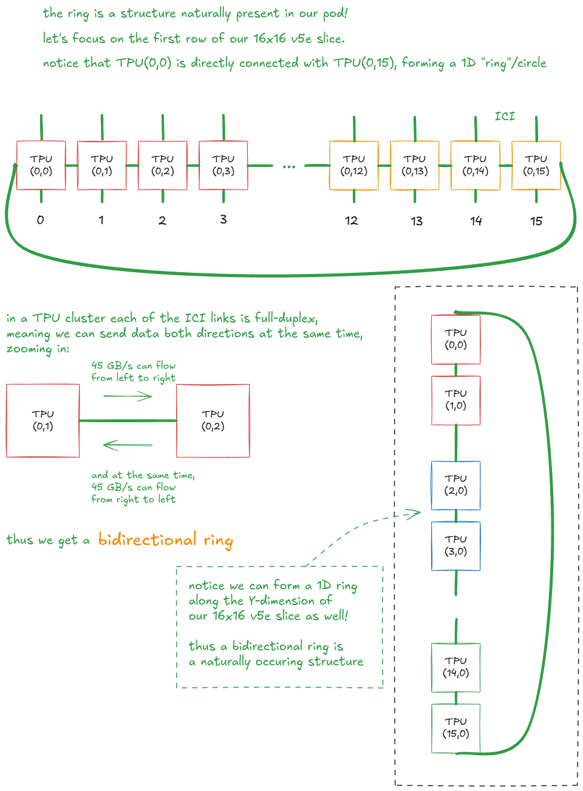

<em>图 10：1D 双向环天然地出现在 16×16 v5e 环面的两个轴上</em>

为了更容易可视化，我们用一个由 8 颗 TPU 芯片组成的小环。在真实的 `v5e` Pod 中，环绕发生在尺寸为 16 时，但在接下来的几张图里，我们假设 8 颗芯片的一行也会环绕：

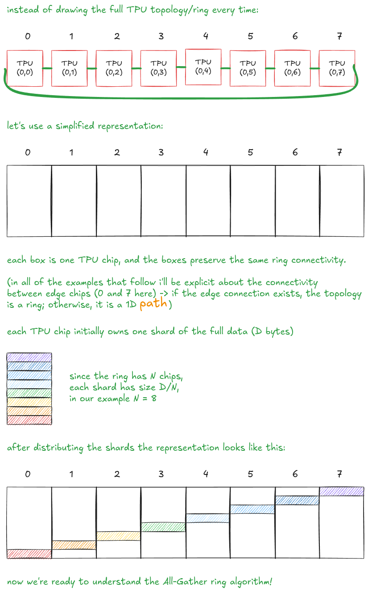

<em>图 11：8 芯片环的简化表示</em>

下图是双向 1D 环上的 All-Gather。这张图值得花点时间研究，放大后跟着一个分片在环上转一圈：

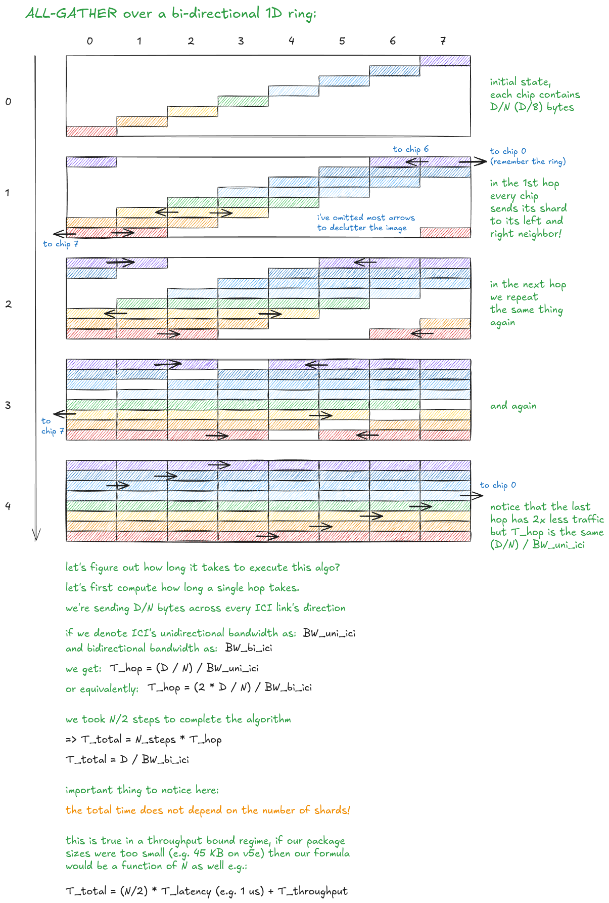

<em>图 12：双向 1D 环上的 All-Gather</em>

作为练习，如果 ICI 链路不是全双工（full-duplex）的，算法会变成什么样？

那样的话，我们可以在单向环上运行 All-Gather。为了让图小一些，我们用一个假设的、大小为 `N = 4` 的环，这样算法只需 `N - 1 = 3` 步即可完成：

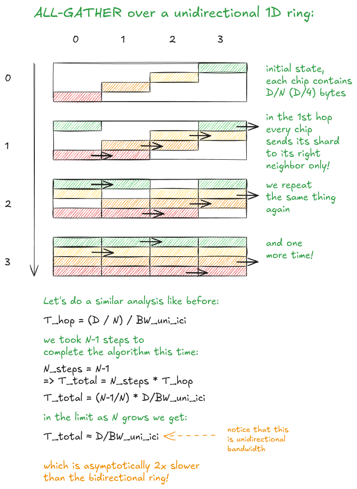

<em>图 13：单向 1D 环上的 All-Gather</em>

更现实的情况是，如果我们取一个没有环绕连接的 TPU slice——例如 4 × 4 的 `v5e` slice——那么沿着那个轴就不再是环，拓扑退化成一条 1D 路径，于是我们退回到在路径（或链）上做 All-Gather：

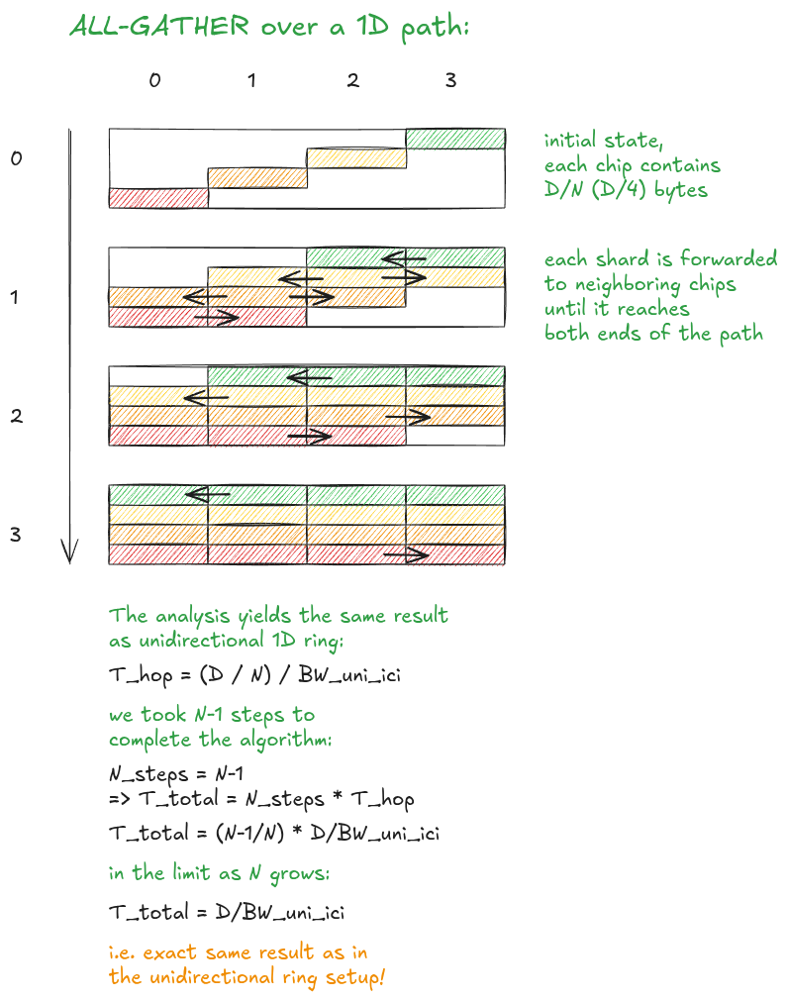

<em>图 14：All-Gather——链/路径</em>

最后，有时我们的数组同时被切分在 TPU slice 的两个轴上，而我们想做 2D 的 All-Gather。

那样的话，我们可以用上全部 4 条相邻的 ICI 链路，相比只用单个轴，能带来 2× 的加速！

我们来建立一下为什么的直觉。假设一个 4 × 4 的 slice，两个轴上都有环绕连接，于是行和列都各自形成环：

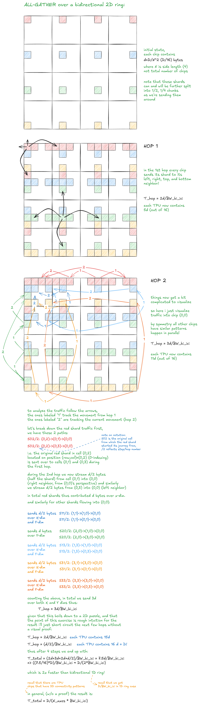

<em>图 15：双向 2D 环上的 All-Gather</em>

All-Gather 就到此为止。

接下来，我们看它的对偶（dual）——Reduce-Scatter，再用它来构造 All-Reduce。

## Reduce-Scatter（及 All-Reduce）：All-Gather 的对偶

和之前一样，先从一个引子讲起：

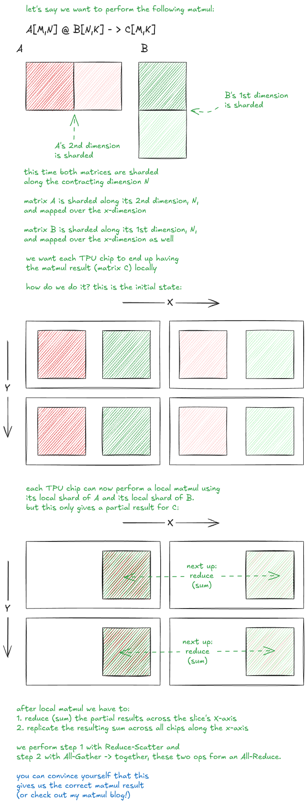

<em>图 16：Reduce-Scatter 的动机</em>

那么我们该如何高效地实现 Reduce-Scatter 呢？

结果它和 All-Gather 非常相似。事实上，你可以把它看作 All-Gather 的对偶：通信调度非常相似，区别在于分片在移动过程中不是被复制，而是被规约（reduce）。

由于通信模式几乎完全一样，其吞吐受限下的时间复杂度也相同：

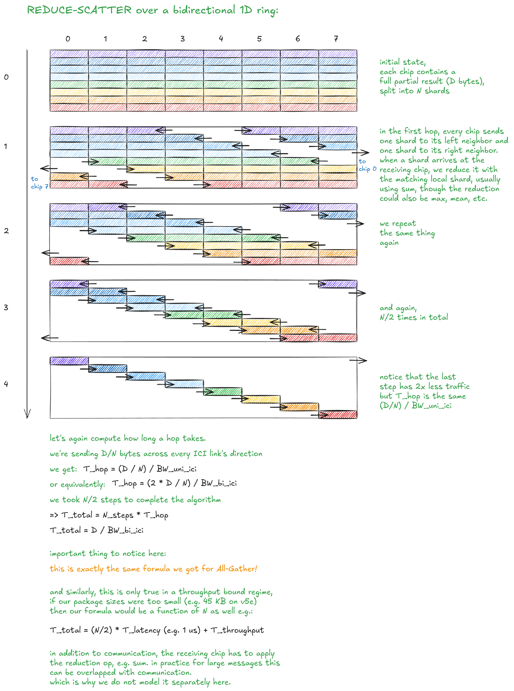

<em>图 17：双向 1D 环上的 Reduce-Scatter</em>

> All-Gather 与 Reduce-Scatter 之间有一种很有用的对偶关系。对于许多切分模式而言，如果前向传播用了 All-Gather，那么反向传播就会用 Reduce-Scatter；反之，如果前向传播用了 Reduce-Scatter，反向传播就会用 All-Gather。这一点值得了解，但由于本文的重点是集合通信算子的机制，这里我就不再展开。

接着上面的引子，现在我们能看到如何用「先 Reduce-Scatter、再 All-Gather」来构造 All-Reduce：

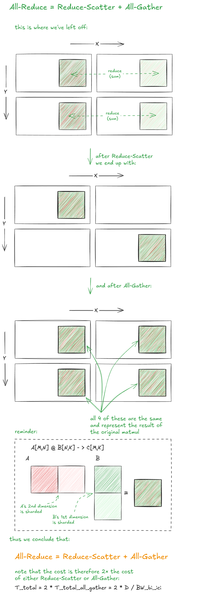

<em>图 18：双向 1D 环上的 All-Reduce</em>

为了保持完整，我们也来看一下假设的单向 1D 环上的 Reduce-Scatter（之所以说「假设」，是因为要在 `v5e` 上得到一个环，我们需要 16 颗 TPU 而不是 4 颗）：

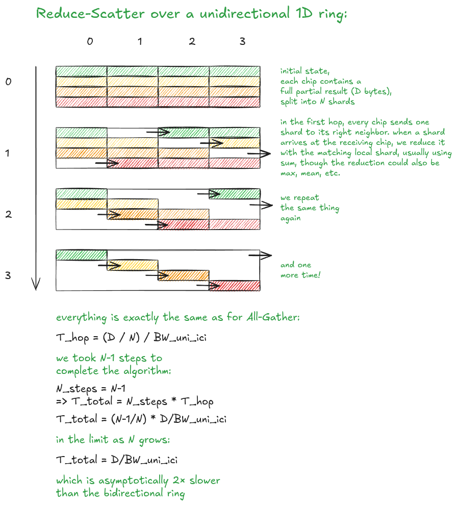

<em>图 19：单向 1D 环上的 Reduce-Scatter</em>

最后，如果我们取一个没有环绕连接的 TPU slice，例如 4 × 4 的 `v5e` slice，那么沿着那个轴就没有环结构。此时我们退回到在 1D 路径/链上做 Reduce-Scatter：

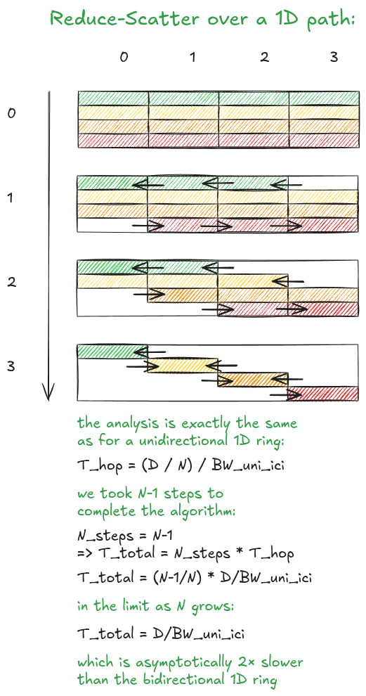

<em>图 20：Reduce-Scatter——链/路径</em>

和 All-Gather 一样，如果数据被切分在多个拓扑轴上，我们就可以并行使用更多的 ICI 链路。在吞吐受限的情况下，总时间大致与我们使用的拓扑轴数量成反比。

Reduce-Scatter 和 All-Reduce 就到此为止！

## All-to-All：分片式转置

现在我们来看最后一个原语：**All-to-All**。

All-to-All 一个典型出现的地方是 MoE（Mixture-of-Experts，专家混合）模型。

> 为简单起见，假设采用 top-1 路由，且每颗芯片一个专家。

在 MoE 层中，路由器（router）会给每个 token 分配一个专家。你可以把路由器理解为：给每个 token 打上目标专家的 ID。

假设专家 0 在 TPU 0 上，专家 1 在 TPU 1 上，以此类推。那么专家 ID 就告诉了我们这个 token 需要被发送到哪颗 TPU 芯片。

因此，每颗芯片一开始持有一批本地 token，但这些 token 可能要发往许多不同芯片上的许多不同专家。

All-to-All 就是完成这种交换的集合通信算子：每颗芯片把属于专家 0 的 token 发给 TPU 0，把属于专家 1 的 token 发给 TPU 1，以此类推。

换句话说，All-to-All 是一种分布式的转置（transpose）：开始时我们按源芯片分组，集合通信完成后，则按目标专家分组。

对于下面的图，我们假设路由模式是完全均衡的：每颗芯片发往其他每颗芯片的数据量都相同。真实的 MoE 路由可能是不均衡的，但均衡的情形能给我们最清晰的心智模型，用来理解 All-to-All 这个原语。

下图是双向 1D 环上的 All-to-All 做法：

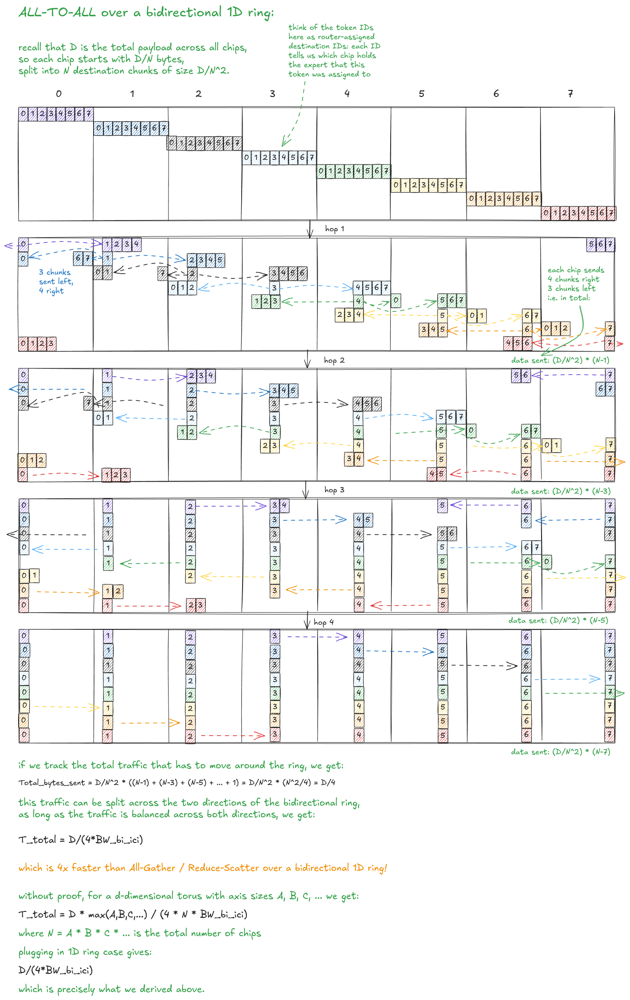

<em>图 21：双向 1D 环上的 All-to-All</em>

下图是单向 1D 环上的 All-to-All：

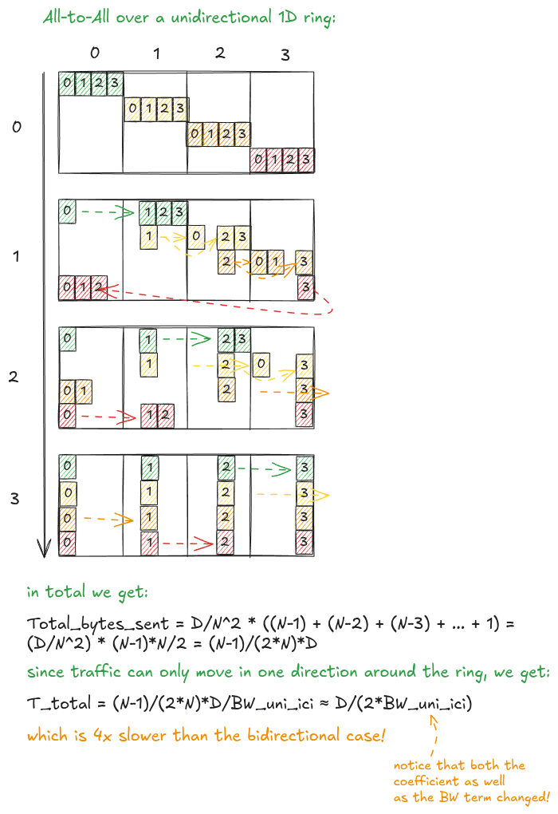

<em>图 22：单向 1D 环上的 All-to-All</em>

和之前的情况一样：没有环绕连接，环就变成路径。因此在 4 × 4 的 `v5e` slice 上，All-to-All 退回到 1D 路径/链算法：

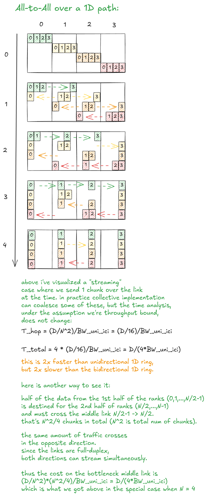

<em>图 23：All-to-All——链/路径</em>

作为本文 TPU 部分的收尾，我们总结一下吞吐受限下的通信时间结果：

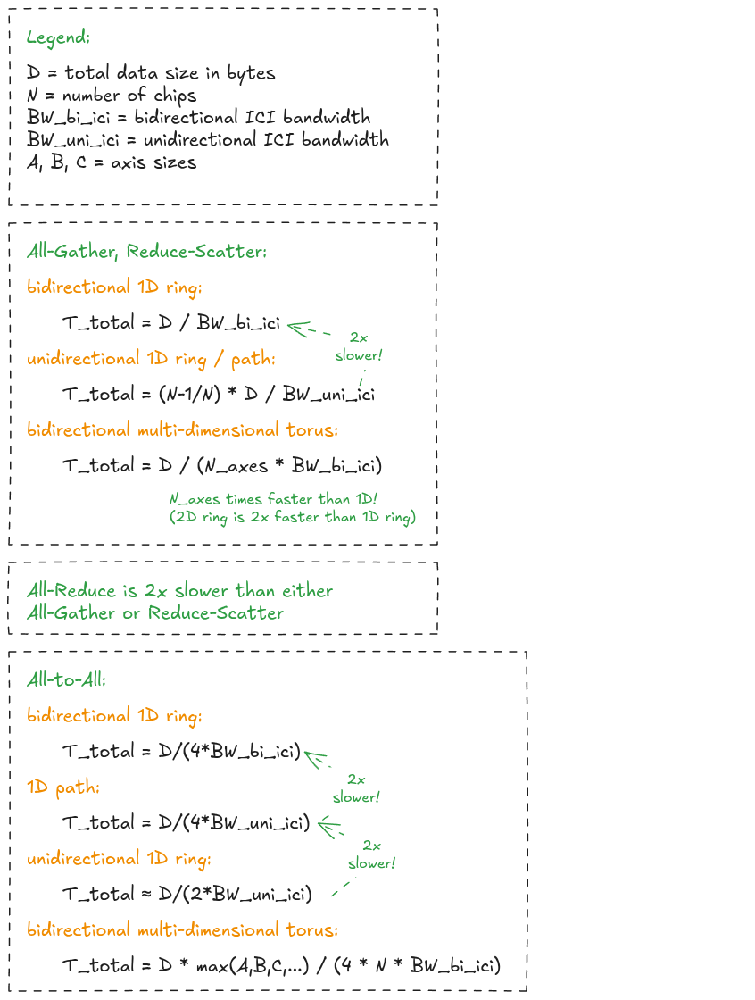

<em>图 24：TPU 集合通信开销汇总</em>

接下来，NVIDIA GPU！

## NVIDIA GPU 集群拓扑：节点、可扩展单元与胖树

与采用最近邻环面连接的 TPU 集群相反，GPU 集群通常被组织成**分层交换网络**（hierarchical switching network）。

本文中，我会聚焦于 NVIDIA DGX H100 SuperPod 的**参考架构**（reference architecture）——一个组织成「胖树」（fat tree）的 1024 颗 GPU 集群。稍后我会解释「胖树」是什么意思。

我会只关注计算网络（compute fabric），也就是分布式训练期间 GPU 之间通信所用的网络。我会忽略用于 checkpoint、权重、日志和数据集的存储网络（storage fabric）；用于 InfiniBand 监控/管理的 UFM；以及用于集群运维的带内（in-band）/带外（out-of-band）管理网络（management fabric）——也就是构成一个可用的 NVIDIA 集群的其他子系统。

下面是基础知识。

第一个组织单元是**节点**（node）。在本节中，我用「节点」指代本地的 NVLink/NVSwitch **scale-up 域**。例如，一个 DGX H100 节点包含 8 颗通过 NVLink 网络连起来的 H100 GPU（而 GB200 NVL72 则有 72 颗 GPU）。

> NVSwitch/NVLink 网络不过是 NVIDIA 对「连接 GPU 的高带宽交换机/互连」的叫法。

在节点内部，GPU 通过 NVSwitch 网络实际上形成了全互联（all-to-all）：每颗 GPU 都能在一跳 NVSwitch 内到达其他任何一颗 GPU。

节点之间则通过 InfiniBand（IB）连接起来，形成 **scale-out**（横向扩展）网络。在 DGX H100 SuperPod 参考架构中，32 个节点组成一个**可扩展单元**（Scalable Unit，SU），通过 InfiniBand **叶交换机**（leaf switch）相连。多个 SU 再通过更高层的**脊交换机**（spine switch）连接。

这一层级结构就构成了胖树。

这种架构之所以叫「胖树」，是因为树越靠近根部越「胖」：上层拥有更大的聚合带宽，因此来自许多节点的流量不会挤进一个狭窄的瓶颈。

**满胖树**（full fat tree）是这一思想中不超额订阅（non-oversubscribed）的特殊版本。在每一层，上行带宽都与下游注入带宽相匹配（这一点在下面的图中会清楚得多）。

> 超额订阅（oversubscription）指的是下游设备能注入的流量超过了上游链路所能承载的量。例如，如果一组节点能向叶层注入 12.8 TB/s，但叶交换机到脊层只有 6.4 TB/s 的上行带宽，那么这个网络就是 2:1 超额订阅的。而满胖树是不超额订阅的：每一层的上行带宽都与下游注入带宽相匹配。

满胖树带来的关键结果是**满对分带宽**（full bisection bandwidth）。

**对分带宽**（bisection bandwidth）是指把集群等分成两半后，两边之间可用的带宽。所以如果我们将一个 128 节点的集群分成两组各 64 节点，那么任一边都能以其*全部*的聚合注入带宽与另一边通信！

更一般地说，对于任意一种划分，跨分区带宽都受限于切分后较小一侧的节点数量。

例如，每个 DGX H100 节点有 8 条 50 GB/s 的链路接入 IB 计算网络，因此拥有 400 GB/s 的单向注入带宽。在满胖树中，任意一组 N 个节点都能以 N × 400 GB/s 的速度单向跨分区通信（假设 N 是切分后较小的一侧）。

在节点内部，同样的思想也适用于本地的 NVLink/NVSwitch 网络。如果我们把 8 颗 GPU 分成两组各 4 颗，其中一侧能以如下速度向另一侧发送：

4 × 450 GB/s = 1.8 TB/s（这正是那 4 颗 GPU 的最大带宽！）

由于网络是全双工的，双向对分带宽为：

2 × 1.8 TB/s = 3.6 TB/s

在可扩展单元这一层，我们有 32 个节点。为了做真正的对分，我们把 SU 分成两组各 16 个节点。其中一侧能以如下速度向另一侧发送：

16 × 400 GB/s = 6.4 TB/s（双向对分带宽 → 12.8 TB/s）

最后，如果我们把集群分成 64 节点对 64 节点，其中一侧能以如下速度向另一侧发送：

64 × 400 GB/s = 25.6 TB/s（双向对分带宽 → 51.2 TB/s）

对于不均匀的划分，比如一侧 88 个节点、另一侧 40 个节点，跨分区带宽受限于较小的一侧：

40 × 400 GB/s = 16 TB/s

有了这个心智模型，我们来更详细地分析 DGX H100 参考架构。可以随意放大查看：

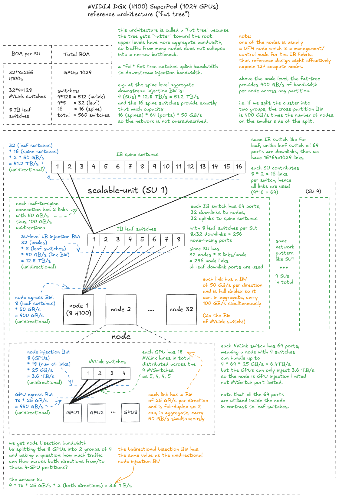

<em>图 25：NVIDIA DGX (H100) SuperPod（1024 颗 GPU）参考架构</em>

在了解了 GPU 集群拓扑之后，我们就可以把注意力转向集合通信算子了。

## 节点内 GPU 集合通信：环、树与 SHARP

在节点内（intra-node，即单个 GPU 节点内部）场景下，集合通信算法看起来与 TPU 的情形相似，因为二者都作用于抽象的环结构，但底层的拓扑不同。

在 TPU 上，环是穿过最近邻 ICI 链路的一条物理路径；在 GPU 上，环则是在 NVSwitch 网络之上选定的一种逻辑顺序。

NVSwitch 网络让我们在 GPU 之间获得了实际上的全互联连接，而集合通信算法则在这种连接模式之上选出一个环。

我们来拆解一下：

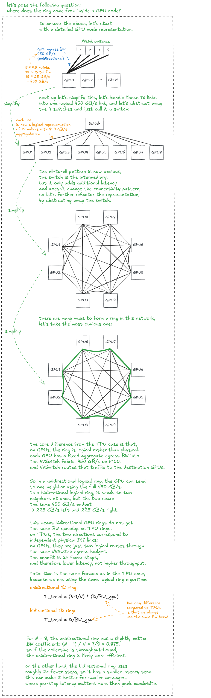

<em>图 26：在 GPU 节点内部构造逻辑环</em>

正如我们已经知道的，All-Reduce 可以表示为「先 Reduce-Scatter、再 All-Gather」，所以在没有专门硬件支持的情况下，它的通信开销大约是其中任何一个原语单独开销的 2 倍。

NVIDIA 的 GPU 交换机（NVSwitch 和 IB 交换机都是）有一项重要的优化，叫做 SHARP，它是一个网内规约（in-network reduction）计算单元。通常，交换机只是在 GPU 之间路由数据；有了 SHARP，交换机还可以自己执行规约操作。例如，GPU 不再互相交换部分和并在本地规约，而是把各自的部分值发进交换机，由交换机求和，再把规约后的结果发回。

这样一来，网络就在数据流动的过程中（in flight）完成了规约，而不用在一个很大程度上受内存带宽限制的 All-Reduce 上耗费 SM 周期和 HBM 带宽，从而让 GPU 腾出来做有用的计算。

> 作为参照，NVLink 4 的 NVSwitch（见于 H100 节点）上，SHARP 拥有 400 GFLOP/s 的 FP32 规约吞吐 [4]。

理论上，SHARP 能让 All-Reduce 快接近 2 倍！在节点内 GPU 数量 `N` 很大的极限情况下，提升趋近于 2×；对于 8 颗 GPU 的节点，理想提升则更接近 1.75×。

那么 SHARP 是如何工作的呢？

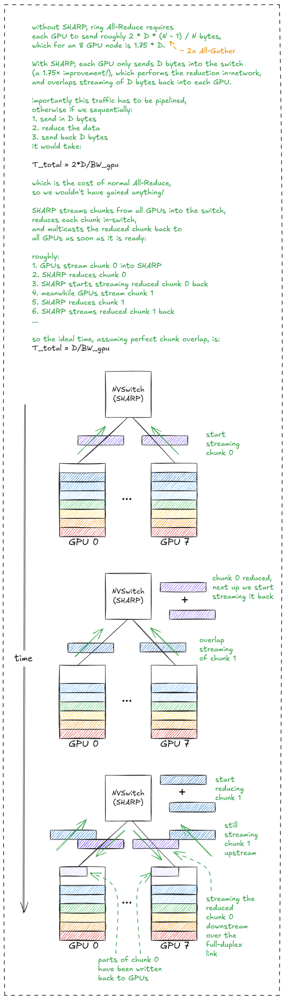

<em>图 27：SHARP——网内规约计算单元</em>

> 经验上，GPU 上的 All-Reduce 可能需要非常大的消息才能接近峰值带宽。在 8×H100 节点上的[较早的 NCCL 测量](https://jax-ml.github.io/scaling-book/gpus/#intra-node-collectives) [5] 中，即便消息大小达到数个 GB，性能仍在爬升；而一旦消息大小降到约 100 MB 以下，带宽就会明显下降。这是与 TPU 的一个实际差异——TPU 往往在很小的消息大小（约 10 MB）下就能达到接近峰值的集合通信带宽。即便为 All-Reduce 开启了 SHARP，我们仍应考虑开销：规约 + 多播（multicast）流水线在实践中并不会完美重叠。实际上，SHARP 带来的加速**只有约 30%** [5][6]！一定要在你自己的具体集群配置上跑微基准测试（microbenchmark）。

> NVLink SHARP 并不局限于规约，它还通过硬件多播来加速 All-Gather 阶段。一块内存区域可以注册为一组 GPU 的多播目标。注册之后，对多播地址的一次普通 CUDA 存储（store）就会被 NVSwitch 网络复制到组内的每颗 GPU——内核本身无需专门的多播指令。一个低效之处在于，多播也会包含源 GPU 自己，尽管它本来就已经有这份数据了！（在 H100 节点中浪费了 1/8 的带宽。）

在 NVSwitch 节点内部，均衡的 All-to-All 所需的通信时间，大约比在双向 1D 环面环上少一半（假设带宽相同），因为每颗 GPU 都能直接向每颗目标 GPU 发送：

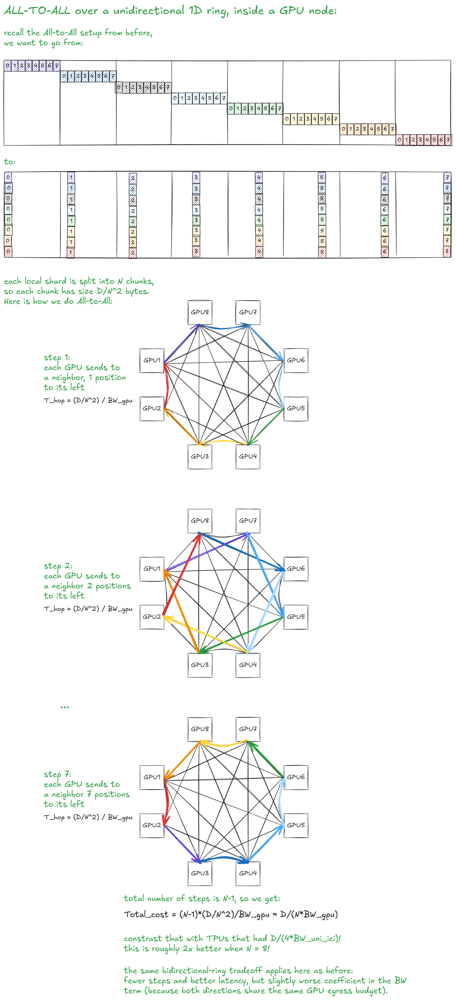

<em>图 28：8-GPU 节点内、逻辑单向环上的稠密 All-to-All</em>

> 对于 8 颗 GPU 的 H100 节点，稠密、均衡的 All-to-All 模型是一个合理的简化，但在 GB200 NVL72 这类系统上，它的代表性就变差了。在一个拥有 72 颗 GPU、每个 token 只选择 8 个专家的 MoE 推理负载中，每个 token 只需要到达大约 8/72≈11% 的 GPU。因此通信会变得稀疏且参差不齐，而不是均匀的 All-to-All：路由器先确定每个 token 的目标专家，系统只把这个 token 发给承载那些专家的 GPU。

在进入节点间（inter-node）集合通信之前，我想先简要介绍一下树式（tree-based）集合通信背后的主要思想。

主要思想是让 GPU 一轮一轮地两两配对，每过一轮，每颗 GPU 持有的数据量就翻倍。这样通信步数就从 `N - 1` 降到 `log₂(N)`。

下图是树式的 All-Gather，通过递归倍增（recursive doubling）实现：

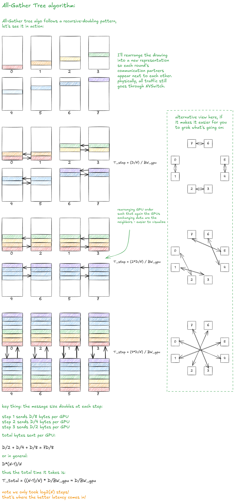

<em>图 29：树式 All-Gather</em>

关于树式算法与环算法，有几点说明。

环算法和树算法都存在步骤依赖，但环通常更容易流水线化（pipeline）。在环中，许多数据块可以连续地在环上流转，让链路保持忙碌。递归倍增的延迟复杂度可能更低，但对于大消息而言，它可能因为不那么利于流水线化而达到比环更低的有效带宽。

在理想带宽模型中，字节开销是相同的（如上图所示），但树式算法把通信轮数从 `N - 1` 减少到了 `log₂(N)`。在实践中，环在大张量上往往能达到更高的有效带宽，因此像 NCCL 这样的库会根据消息大小和拓扑，在环、树和混合算法之间做出选择。

为求完整，下图是通过递归减半（recursive halving）实现的 Reduce-Scatter：

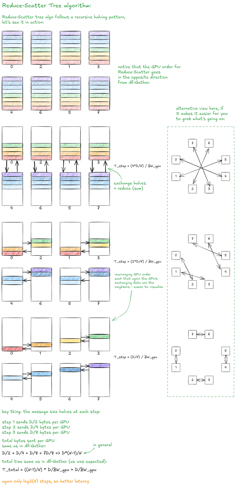

<em>图 30：树式 Reduce-Scatter</em>

接下来，我们看看当我们走出单个 GPU 节点、进入节点间场景时，会发生什么变化。

## 跨节点 GPU 集合通信：基于 InfiniBand 的分层算法

由于要跨多个层级（节点级、SU 级、脊级）进行流水线化，算法的底层细节变得更加复杂。

一个不错的心智模型是：想象在整个集群的所有节点之上运行一个节点间环（得益于不超额订阅的满胖树，我们能做到这一点）。

因此，对于大消息，All-Gather 或 Reduce-Scatter 的一个不错的一阶近似是（其中 `D` 是张量大小，单位字节）：

`T_total` ≈ `D` / `BW_node` = `D` / `400e9`

一个稍精确一点的模型还会把节点内阶段考虑进来。在分层集合通信中，我们通常既有走 IB 的 scale-out 流量，也有走 NVLink/NVSwitch 的本地流量，而且这些阶段往往可以流水线化。所以总时间更接近两项中较慢的那一个：

`T_total` ≈ max(`D`/`BW_gpu`, `D`/`BW_node`)

我们先看第一个跨节点集合通信算子——All-Gather：

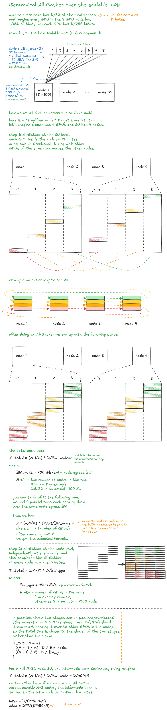

<em>图 31：可扩展单元上的分层 All-Gather</em>

> 在这些例子中，我只展示单个 SU 内部的通信。加上脊层网络并不会从本质上改变算法——我们仍然运行同一种分层集合通信（只是多跨拓扑的一层而已），但它会让可视化变得复杂，所以我就略过脊级的集合通信了。

> 一个节点的聚合节点间带宽，并不总是能在所有 GPU 之间完全自由地通用（不像我上面分享的简单模型那样）。GPU 集群常常被组织成多条并行的网络轨道（rail），特定的 GPU 对网络有着优先的路径。因此，要跑满节点级带宽，就取决于 rail 感知（rail-aware）的 rank 布局，以及这些路径之间均衡的流量。

接下来，我们看分层的 All-Reduce（我会略过分层的 Reduce-Scatter，因为它的结构与分层 All-Gather 高度相似）：

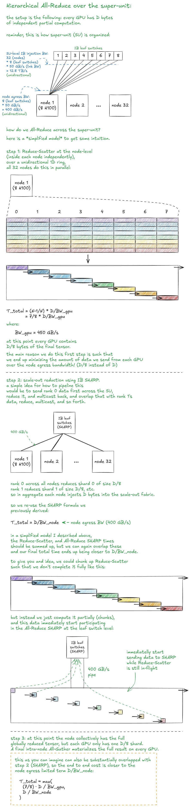

<em>图 32：可扩展单元上的分层 All-Reduce</em>

有一个微妙之处：被 All-Reduce 的张量本身，可能还沿着另一个并行轴被切分。

例如，在 Megatron 风格的训练（张量/模型并行）中，一个权重矩阵可能沿着张量并行轴 `Y` 被切分，而它的梯度则沿着数据并行轴 `X` 被规约。

All-Reduce 并不跨张量并行的 rank 执行。那些 rank 持有的是不同的分片，它们之间没有可以逐元素规约的东西。

相反，对于每个固定的张量并行分片，我们在对应的数据并行副本之间做 AllReduce。

我们来看一个具体的例子：

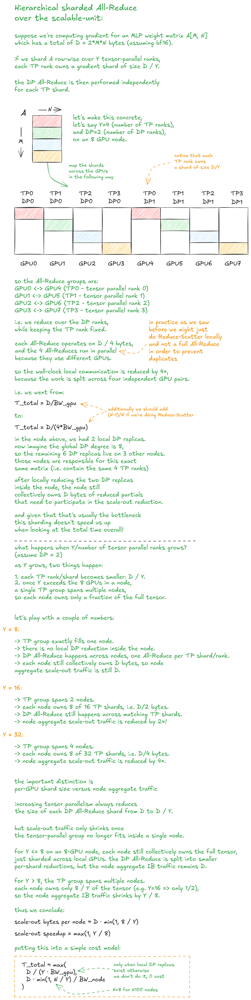

<em>图 33：可扩展单元上的分层分片 All-Reduce</em>

最后，我们看 SU 上的分层 All-to-All。

与 All-Reduce 不同，All-to-All 无法通过先做一次本地规约来压缩数据（因为每个数据块都有特定的目的地）：

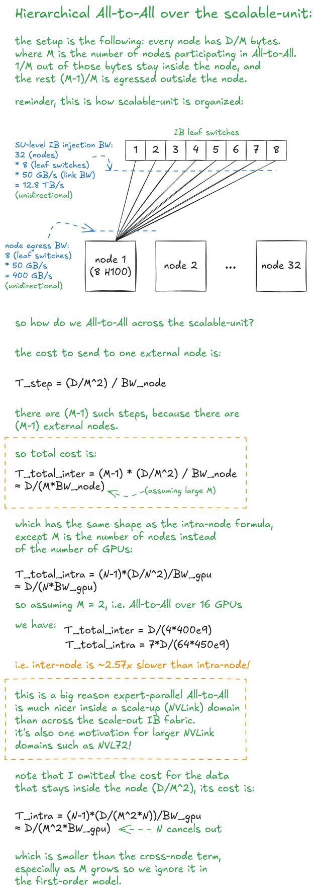

<em>图 34：可扩展单元上的分层 All-to-All</em>

和 TPU 部分的做法一样，我们把 GPU 的开销模型汇总到一处：

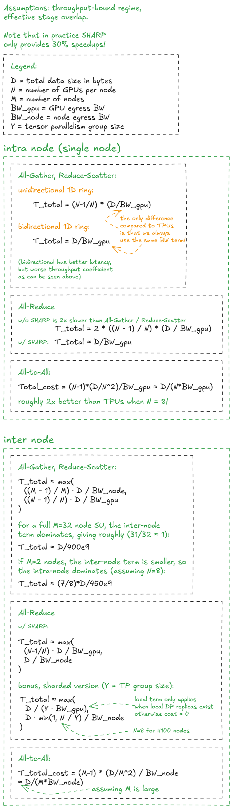

<em>图 35：节点内与节点间集合通信的 GPU 集合通信开销汇总</em>

## 结语

呼，这篇可真长！

最初的想法不过是「要不我就画四张图，把 All-Gather、Reduce-Scatter、All-Reduce 和 All-to-All 都讲一遍，好让我自己更明白，应该花不了一天吧，对吧对吧」，结果不知怎么的就变成了现在这样一篇东西。

在这个过程中，我意识到，只有理解了底层的硬件拓扑，集合通信算法才真正讲得通。TPU 相对好分析一些，但我没法跳过 GPU——我太爱它们了。环很酷，但我也想搞懂树算法。然后还有 SHARP、胖树，还有分层集合通信。:')

于是范围一点点扩大，这篇博客也就这样一点点成形了。不过是个支线任务罢了。

希望你喜欢！:)

> 如果你在文中发现了任何错误，请直接私信我——可以在 [X](https://x.com/gordic_aleksa) 或 [LinkedIn](https://www.linkedin.com/in/aleksagordic/) 上给我留言，或者通过[匿名反馈](https://docs.google.com/forms/d/1z1fEirrN2xtGxAsJvptpM7yV4ByT5SF25S-XiMPrXNA/edit)告诉我。

## 致谢

感谢我的朋友们 [Aroun Demeure](https://github.com/ademeure)（前 Magic 的 GPU & AI 工程师，前 Apple 和 Imagination 的 GPU 架构师）、[Axel Feldmann](https://x.com/axel_s_feldmann)（Jane Street 的 ML 性能工程师）以及 [Pranjal Shankhdhar](https://x.com/pranjalssh)（前 xAI 的 GPU 内核工程师）阅读了本文的预发布版本并给出反馈！

Arun 把 GPU 部分的讨论扩展到了均衡 All-to-All 之外，重点指出了 NVL72 的任意互联（any-to-any）拓扑、稀疏且不均衡的 MoE 路由，以及 NVLink SHARP 的内存式多播/规约模型及其实际权衡。

Axel 通过强调 rail 优化和 SHARP 带来的 SM/HBM 卸载收益，打磨了 GPU 部分，然后用 H100 的实测数据（显示 SHARP 在实际中约 1.3× 的加速，以及在约 1 GB 处接近饱和的集合通信带宽）为性能讨论提供了依据。

Pranjal 独立地印证了关于 rail 优化、以及 SHARP 理论上的 2× 加速与实际中通常观察到的约 30% 提升之间差距的观点。

想在我发布新文章时收到通知吗？

## 参考文献

1. "TPU 8t and TPU 8i technical deep dive", [https://cloud.google.com/blog/products/compute/tpu-8t-and-tpu-8i-technical-deep-dive](https://cloud.google.com/blog/products/compute/tpu-8t-and-tpu-8i-technical-deep-dive)
2. "TPU topology visualizer", [https://tpu-visualizer.uc.r.appspot.com/](https://tpu-visualizer.uc.r.appspot.com/)
3. "How to Scale Your Model", [https://jax-ml.github.io/scaling-book/](https://jax-ml.github.io/scaling-book/)
4. "NVSwitch Hot Chips 2022", [https://hc34.hotchips.org../assets/program/conference/day2/Network%20and%20Switches/NVSwitch%20HotChips%202022%20r5.pdf](https://hc34.hotchips.org../assets/program/conference/day2/Network%20and%20Switches/NVSwitch%20HotChips%202022%20r5.pdf)
5. "How to Scale Your Model: GPUs / intra-node collectives", [https://jax-ml.github.io/scaling-book/gpus/#intra-node-collectives](https://jax-ml.github.io/scaling-book/gpus/#intra-node-collectives)
6. Axel 用 NCCL 2.29.7 在一个 32-GPU 的 H100 InfiniBand 环境上独立重跑了基准测试，印证了上述结果：他在 4 GB 的 All-Reduce 上同样只观察到约 1.3× 的加速。Pranjal 也报告了同样的结果。Arun 表示，这更多是 NCCL 的问题，而非 SHARP 的问题。
