---

> **译者注：** 本文翻译自 Google 的白皮书《Introduction to Agents》（2026 年 5 月更新），作者为 Alan Blount、Antonio Gulli、Shubham Saboo、Michael Zimmermann 和 Vladimir Vuskovic。翻译保持原文的内容与结构，常见技术术语保留英文，生僻术语在首次出现时附中文注释。

---

作者：Alan Blount、Antonio Gulli、Shubham Saboo、Michael Zimmermann、Vladimir Vuskovic

2026 年 5 月更新

## 致谢

**内容贡献者**

- Enrique Chan
- Mike Clark
- Derek Egan
- Kanchana Patlolla
- Julia Wiesinger

**策划与编辑**

- Anant Nawalgaria
- Kanchana Patlolla

**设计**

- Michael Lanning

## 目录

- 从预测式 AI 到自主智能体 —— 6
- AI 智能体入门 —— 8
- 智能体的问题求解流程 —— 10
- 智能体系统分类 —— 14
  - Level 0：核心推理系统 —— 15
  - Level 1：连接外部工具的问题解决者 —— 15
  - Level 2：战略型问题解决者 —— 16
  - Level 3：协作式多智能体系统 —— 17
  - Level 4：自我演化系统 —— 18
- 智能体核心架构：模型、工具与编排 —— 19
  - 模型：AI 智能体的“大脑” —— 19
  - 工具：AI 智能体的“双手” —— 20
    - 获取信息：扎根现实 —— 21
    - 执行动作：改变世界 —— 21
    - Function Calling（函数调用）：把工具接入智能体 —— 22
  - 编排层 —— 22
  - 核心设计抉择 —— 23
  - 用领域知识与人格设定下达指令 —— 23
  - 用上下文增强 —— 24
  - 多智能体系统与设计模式 —— 24
- 智能体部署与服务 —— 26
- Agent Ops：以结构化方法应对不可预测性 —— 27
  - 衡量真正重要的指标：像 A/B 实验一样度量成功 —— 29
  - 以质量评估取代通过/失败：使用 LM Judge —— 29
  - 指标驱动开发：部署前的 Go/No-Go 决策 —— 30
  - 借助 OpenTelemetry Trace 调试：回答“为什么？” —— 30
  - 珍视人类反馈：为自动化指引方向 —— 31
- 智能体互操作性 —— 31
  - 智能体与人 —— 32
  - 智能体与智能体 —— 33
  - 智能体与金钱 —— 34
- 保护单个智能体：信任的权衡 —— 35
  - 智能体身份：一类全新的主体 —— 36
  - 保护 ADK 智能体 —— 38
- 从单个智能体扩展到企业级集群 —— 40
  - 安全与隐私：加固智能体前沿 —— 40
  - 智能体治理：用控制平面取代无序扩张 —— 41
- 智能体如何演化与学习 —— 43
  - 智能体如何学习与自我演化 —— 43
  - 仿真与 Agent Gym：下一个前沿 —— 46
- 高级智能体案例 —— 47
  - Google Co-Scientist —— 47
  - AlphaEvolve 智能体 —— 49
- 结语 —— 51
- 尾注 —— 52

---

> 智能体是语言模型的自然演进，让语言模型在软件中真正派上用场。

## 从预测式 AI 到自主智能体

人工智能正在改变。过去这些年，人们关注的焦点一直是那些擅长被动、单一任务的模型：回答问题、翻译文本，或者根据提示词生成图片。这种范式固然强大，但每一步都离不开人的指挥。如今，一场范式转变正在发生：AI 不再只是预测或生成内容，而是走向一类能够自主解决问题、执行任务的新型软件。

这一新前沿围绕 AI 智能体展开。智能体并不是把 AI 模型放进一条静态流程那么简单；它是一个完整的应用，会制定计划、采取行动，朝着目标推进。它把语言模型（LM）的**推理**能力与实际的**行动**能力结合起来，因而能处理模型单靠自己无法完成的复杂多步骤任务。最关键的一点是，智能体能独立工作：它会自行判断达成目标需要哪些后续步骤，无需人在每一步旁边指点。

本文档是五篇系列文章的第一篇，为正在从概念验证走向稳健、生产级智能体系统的开发者、架构师和产品负责人提供一份正式指南。搭建简单的原型并不难，但确保安全性、质量和可靠性，却是一项不小的挑战。本文为此提供全面的基础：

- **核心解剖：**把智能体拆解为三个必不可少的组成部分：负责推理的模型、可执行操作的工具，以及负责统筹的编排层。
- **能力分类：**对智能体进行分类，从能连接外部工具的简单问题解决者，到复杂的协作式多智能体系统。
- **架构设计：**深入探讨每个组件在实际设计中的考量，从模型选型到工具实现。
- **面向生产构建：**建立 Agent Ops（智能体运维）体系，用于评估、调试、保障安全和扩展智能体系统——从单个实例，到纳入企业治理的智能体集群。

在此前的《Agents》白皮书¹和《Agent Companion》²的基础上，本指南为你提供成功构建、部署和管理新一代智能应用所需的基础概念与战略框架——这类应用能够推理、行动和观察，从而达成目标³。

> 语言不足以描述人类与 AI 的互动。我们总爱把 AI 拟人化，用“思考”“推理”“知道”这些属于人的词来描述它。我们还没有词能区分“凭语义理解而知道”和“凭大概率最大化奖励函数而知道”。这是两种不同的“知道”，但 99.X% 的情况下，结果一模一样。

## AI 智能体入门

最简单地讲，AI 智能体可以定义为模型、工具、编排层和运行时服务的组合——它让 LM 在循环中运转，以完成某个目标。这四个要素构成了任何自主系统的基本架构。

- **模型（“大脑”）：**核心语言模型（LM）或基础模型，充当智能体的中心推理引擎，负责处理信息、评估选项并做出决策。模型的类型（通用、微调或多模态）决定了智能体的认知能力。智能体系统是 LM 输入 context window 的终极策展人。
- **工具（“双手”）：**这些机制把智能体的推理与外部世界连接起来，使它能够采取文本生成之外的动作。工具包括 API 扩展、代码函数和数据存储（如数据库或向量库），用来获取实时、符合事实的信息。智能体系统让 LM 规划该用哪些工具、执行工具，再把工具返回的结果放进下一次 LM 调用的输入 context window 中。
- **编排层（“神经系统”）：**这是管理智能体运行循环的统筹流程，负责规划、记忆（状态）和推理策略的执行。这一层借助提示框架和推理技巧（如 Chain-of-Thought（思维链）⁴ 或 ReAct⁵），把复杂目标拆解成步骤，并判断何时该思考、何时该调用工具。它还负责赋予智能体“记住”的能力。
- **部署（“身体和双腿”）：**在笔记本电脑上搭智能体，适合做原型；但要让它成为可靠、随时可用的服务，必须部署到生产环境。这意味着把智能体托管在安全、可扩展的服务器上，并接入监控、日志和管理等必要的生产服务。部署之后，用户可以通过图形界面访问智能体，其他智能体也可以通过 Agent-to-Agent（A2A）API 以编程方式调用它。

归根结底，构建生成式 AI 智能体是一种全新的解题方式。传统开发者像“泥瓦匠”，把每一个逻辑步骤都精确地定义好；智能体开发者则更像导演。你不再为每个动作编写明确的代码，而是布置场景（指导性的指令和 prompt）、挑选演员（工具和 API）、提供必要的背景（数据）。你的主要工作，变成了引导这位自主的“演员”交出预期的表演。

你很快会发现，LM 最大的优势——那种惊人的灵活性——恰恰也是最让人头疼的地方。大语言模型什么都能做，反而很难让它稳定、完美地只做某一件事。过去我们叫它 prompt engineering（提示工程），现在叫 context engineering（上下文工程），目的都是引导 LM 生成想要的输出。每一次调用 LM，我们都会输入指令、事实、可调用的工具、示例、会话历史、用户画像等信息——用恰到好处的信息填满 context window，从而得到需要的结果。智能体就是这样的软件：管理 LM 的输入，把活干成。

出了问题，调试就成了关键。“Agent Ops”（智能体运维）本质上重新定义了人们熟悉的“度量—分析—系统优化”循环。借助 trace（追踪记录）和日志，你可以观察智能体的“思考过程”，发现它偏离预期执行路径的地方。随着模型演进、框架完善，开发者的职责变成了提供关键组件：领域专业知识、明确的人格设定，以及与完成任务所必需的工具之间的无缝集成。要记住，全面的评估和测试，往往比最初那句 prompt 更有分量。

当一个智能体被精确配置好——有清晰的指令、可靠的工具、充当记忆的整合上下文、出色的用户界面，以及规划与问题求解的能力和通用的世界知识——它就不再只是“工作流自动化”了。它开始像一个协作伙伴那样工作：高效、适应力强、能力出众，是你团队里一位新成员。

本质上，智能体是一套专注于 context window 策展艺术的系统。它不停循环：组装上下文、向模型发出 prompt、观察结果，再为下一步重新组装上下文。上下文可以包含系统指令、用户输入、会话历史、长期记忆、来自权威信源且可作为事实依据的知识、可用工具，以及已经调用过的工具返回的结果。对模型注意力进行这种精细管理，它的推理能力才能应对新情况、完成目标。

## 智能体的问题求解流程

我们已经把 AI 智能体定义为一个完整的目标导向应用，它集成了推理模型、可执行操作的工具和负责统筹的编排层。简化一点说，就是“让 LM 带着工具在循环中运转，以完成某个目标”。

但系统究竟怎么运作？从收到请求到给出结果，智能体都做了些什么？

从根本上说，智能体依靠一个持续循环的过程来实现目标。这个循环可能变得非常复杂，但可以拆成五个基本步骤；《Agentic System Design》一书对此有详细讨论：⁶

1. **获取任务：**流程由一个具体、高层次的目标启动。这个任务可能来自用户（例如“安排团队参加即将举行的会议的行程”），也可能来自自动触发器（例如“来了一张新的高优先级客户工单”）。
2. **扫描场景：**智能体感知周围环境，收集上下文。编排层会去查看手头有哪些资源：“用户的请求说了什么？”“我的记忆里有哪些信息？这个任务我是不是已经试过了？用户上周有没有给过我指示？”“我的工具能访问哪些东西，比如日历、数据库或 API？”
3. **深入思考：**这是智能体由推理模型驱动的核心“思考”循环。它把**任务**（第 1 步）和**场景**（第 2 步）放在一起分析，拟定计划。这通常不是一闪而过的念头，而是一连串推理：“要订行程，我得先知道团队里有哪些人。我会调用 `get_team_roster` 工具。然后还要通过 `calendar_api` 查他们的空闲时间。”
4. **采取行动：**编排层执行计划中的第一个具体步骤：选择合适的**工具**并调用它——可能是调用 API、运行一段代码函数，或者查询数据库。这是智能体在自身推理之外，对真实世界采取行动。
5. **观察并迭代：**智能体观察行动的结果。`get_team_roster` 工具返回了五个人的名单。这条新信息被加入智能体的上下文，也就是“记忆”。随后循环重复，回到第 3 步：“名单到手了，下一步是查这五个人的日历。我会用 `calendar_api`。”

这个“思考、行动、观察”的循环会一直持续——由**编排层**管理、由**模型**推理、由**工具**执行——直到智能体的内部计划全部完成，最初的**任务**得以实现。

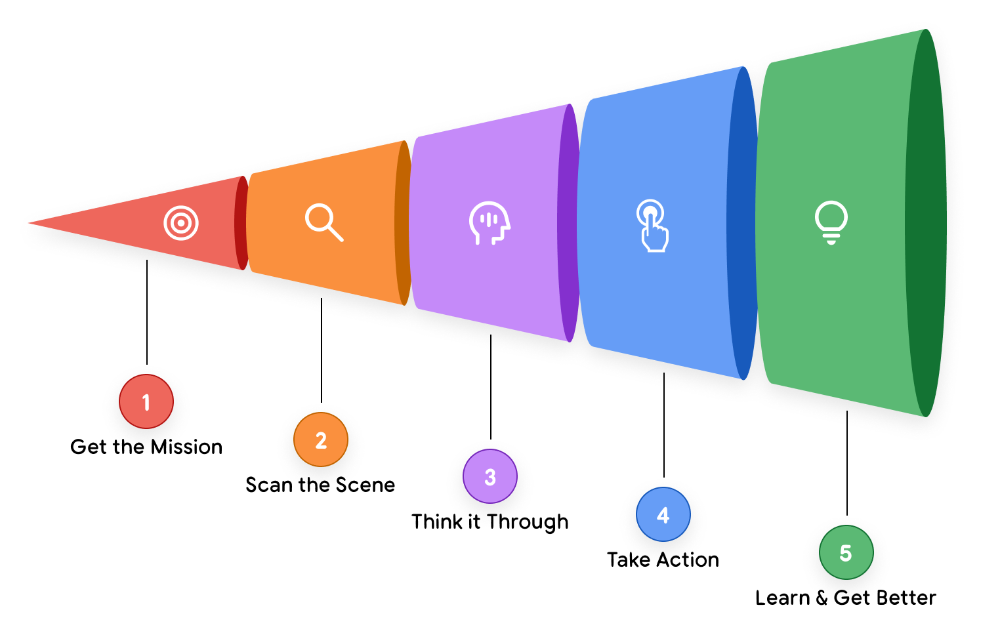

**图 1：**智能体 AI 的问题求解过程

下面看一个真实场景：客服智能体如何走完这五步。

假设用户问：“我的订单 #12345 到哪儿了？”

智能体没有立刻行动，而是先进入**“深入思考”**阶段，拟定一套完整策略。它是这样推理的：

> 用户想知道配送状态。要给出完整答复，我需要一个**多步计划**：
>
> 1. **定位：**先在内部数据库里找到这笔订单，确认它存在，并取出详情。
> 2. **追踪：**从详情中提取承运商的物流单号，然后调用外部承运商的 API，查询实时状态。
> 3. **回复：**最后，把查到的信息整理成一段清晰、有用的答复，交给用户。

带着这套多步计划，智能体开始执行。

在第一个“行动”阶段，它执行计划的第一步，调用 `find_order("12345")` 工具。它观察到结果：一份完整的订单记录，其中包含物流单号“ZYX987”。

智能体的编排层发现计划的第一部分已经完成，立刻推进到第二部分：调用 `get_shipping_status("ZYX987")` 工具。它观察到新的结果：“Out for Delivery”（正在派送）。

最后，数据收集阶段全部执行完毕，智能体进入“回复”步骤。它确认所需信息已经齐全，规划好最终消息，然后生成回复：“您的订单 #12345 正在派送中！”

## 智能体系统分类

理解这个五步运行循环，只是拼图的第一块。第二块，是认识到这个循环可以按复杂程度扩展，从而造出不同类别的智能体。对架构师或产品负责人来说，最初的关键决策之一，就是确定要构建哪种类型的智能体。

我们可以把智能体系统分成几个大的层级，后一层建立在前一层的能力之上。

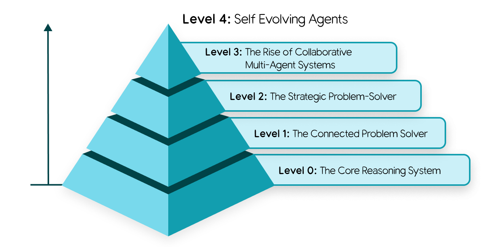

**图 2：**分为五个层级的智能体系统

### Level 0：核心推理系统

在拥有智能体之前，得先有最基础形态的“大脑”：推理引擎本身。在这个配置里，语言模型（LM）孤立运行，只凭庞大的预训练知识作答，没有工具、没有记忆，也不与实时环境交互。

它的长处来自这种大规模训练：它能深入解释既有概念，也能规划如何着手解决一个问题。代价则是完全没有实时感知能力；从功能上说，它对训练数据之外的任何事件或事实都“看不见”。

比如，它能讲清楚职业棒球的规则，也能把纽约洋基队的完整队史说得头头是道。但如果你问：“洋基队昨晚那场比赛的最终比分是多少？”它答不上来。那场比赛发生在训练数据收集之后，是一个具体的现实事件，它的知识里根本没有这条信息。

### Level 1：连接外部工具的问题解决者

到了这一层，推理引擎通过连接和使用外部工具——也就是架构中的“双手”——成为一个能实际干活的智能体。它解决问题时，不再局限于静态的预训练知识。

借助五步循环，智能体现在能回答刚才那个问题了。拿到任务——“洋基队昨晚比赛的最终比分是多少？”——它的“思考”步骤会判断出这需要实时数据；“行动”步骤则调用工具，比如带上正确日期和搜索词的 Google Search API；随后“观察”搜索结果（例如“洋基队 5 比 3 获胜”），把这个事实整合成最终答案。

这种与世界交互的基本能力——无论是用搜索工具查比分、用金融 API 查实时股价，还是通过 RAG（检索增强生成）查询数据库——正是 Level 1 智能体的核心能力。

### Level 2：战略型问题解决者

Level 2 意味着能力的一次大幅扩展：从执行简单任务，转向为复杂的多部分目标做战略规划。这里浮现的关键技能是 **context engineering（上下文工程）**：智能体能够主动挑选、打包并管理每一步计划最相关的信息。

智能体的准确率，取决于一个聚焦且高质量的上下文。context engineering 会对模型有限的注意力加以筛选编排，避免过载，确保运行高效。

举个例子，任务是：“找一家不错的咖啡店，位置要在我位于山景城 1600 Amphitheatre Parkway 的办公室，和客户位于旧金山 1 Market St 的办公室之间，最好在中间点。”

Level 2 智能体会着手制定计划：

1. **思考：**“我得先找到中点。”
   - **行动：**用两个地址调用 Maps 工具。
   - **观察：**“中点是加利福尼亚州的米尔布雷（Millbrae, CA）。”
2. **思考：**“现在要在米尔布雷找咖啡店。用户要‘好’的，那我就搜评分 4 星及以上的店。”
   - **行动：**调用 `google_places` 工具，参数为 `query="coffee shop in Millbrae, CA"`、`min_rating=4.0`。（这就是 context engineering——它根据上一步的输出，自动生成了一个更聚焦的新搜索查询。）
   - **观察：**“搜索返回了‘Millbrae Coffee’和‘The Daily Grind’。”
3. **思考：**“我把这些结果整理一下，呈现给用户。”

这种战略规划还能让智能体主动提供帮助。比如，它读完一封冗长的航班确认邮件，从中提炼出关键上下文（航班号、日期），再把它加进你的日历。

### Level 3：协作式多智能体系统

到了最高层级，范式彻底转变。我们不再构建一个无所不能的“超级智能体”，而是转向由“专家团队”协同工作——这种模式直接映射了人类组织。系统的集体力量，正来自这种分工。

在这里，智能体把其他智能体当作工具来用。设想一个“项目经理”智能体接到任务：“发布我们的新款‘Solaris’耳机。”

项目经理智能体不会自己包揽全部工作。它的“行动”，就是给手下的专业智能体团队分派新任务——和现实中的工作方式很像：

1. **委派给 MarketResearchAgent：**“分析降噪耳机的竞品定价，明天之前交一份摘要文档。”
2. **委派给 MarketingAgent：**“以‘Solaris’产品规格表为上下文，起草三个版本的新闻稿。”
3. **委派给 WebDevAgent：**“根据附件里的设计稿，生成新产品页面的 HTML。”

这种协作模式目前还受制于当今 LM 的推理能力上限，但它代表了端到端自动化复杂业务流程的前沿方向。

### Level 4：自我演化系统

Level 4 是从“委派”到“自主创造与适应”的一次深刻跃迁。到了这一层，智能体系统能发现自身能力的缺口，并动态创造新工具甚至新智能体来补上。它不再使用一套固定的资源，而是主动扩展资源。

沿用前面的例子，负责“Solaris”发布的项目经理智能体可能意识到，自己需要监测社交媒体情绪，但团队里没有这样的工具或智能体。

1. **思考（元推理）：**“我得追踪‘Solaris’在社交媒体上的热度，但我没有这个能力。”
2. **行动（自主创造）：**它没有就此失败，而是调用一个高层次的 AgentCreator 工具，并下达新任务：“构建一个新智能体，监测社交媒体上‘Solaris headphones’这个关键词，做情绪分析，每天汇报一份摘要。”
3. **观察：**一个新的专用智能体 SentimentAnalysisAgent 被创建、测试，并即时加入团队，随时为最初的任务出力。

这种自主性——系统能够动态扩展自身能力——让一群智能体变成一个真正会学习、会演化的组织。

## 智能体核心架构：模型、工具与编排

我们已经知道智能体能做什么、如何扩展。但它究竟怎么造？从概念落到代码，关键在于三个核心组件的具体架构设计。

### 模型：AI 智能体的“大脑”

LM 是智能体的推理核心。选哪个模型，是一项关键架构决策，直接决定智能体的认知能力、运行成本和速度。不过，把这件事简化成“挑 benchmark 分数最高的模型”，往往就是失败的开始。智能体在生产环境里能否成功，很少取决于那些通用的学术 benchmark。

要在真实世界中成功，模型必须在**智能体的基本功**上过硬：既要有出色的**推理**能力，能应对复杂的多步骤问题；也要能可靠地**使用工具**，与外部世界交互⁷。

要做好这件事，先定义业务问题，再用能直接反映业务结果的指标去测试模型。智能体要写代码，就在你自己的私有代码库上测；要处理保险理赔，就评估它从你特定格式的文档中提取信息的能力。然后，把这些分析和成本、延迟等现实因素放在一起权衡。所谓“最好的”模型，就是在你这项具体任务上，质量、速度和价格恰好落在最佳交点的那个⁸。

你也可以选多个模型，组成一支“专家团队”。杀鸡焉用牛刀。稳健的智能体架构，可以用 **Gemini 3.2 Pro** 这样的前沿模型来做重活——比如最初的规划和复杂推理；再把分类用户意图、总结文本这类简单、量大的任务，智能地路由给更快、更省钱的模型，比如 **Gemini 3.2 Flash** 系列，或者 **Gemma 4** 这样的开放模型。模型路由可以自动进行，也可以硬编码，但无论哪种方式，它都是同时优化性能和成本的关键策略⁹。

处理多种数据类型也是同样的道理。像 Gemini live mode¹⁰ 这样原生多模态的模型，为处理图像和音频提供了一条顺畅路径；另一种做法是使用 Cloud Vision API¹¹、Speech-to-Text API¹² 这类专用工具。后一种模式下，世界先被转换成文本，再交给纯语言模型推理。这增加了灵活性，也便于选用各个领域最好的组件，但同时也带来了明显的复杂度。

最后，AI 领域始终在快速演变。你今天选定的模型，半年后就会过时。“设好就不管”的心态维持不下去。要为这种现实做设计，就得投资一套灵活的运营框架——也就是 Agent Ops 实践¹³。借助稳健的 CI/CD 流水线，持续用关键业务指标评估新模型，你就能降低升级风险、加快升级速度，让智能体始终由当下最好的大脑驱动，而不必推倒重来。

### 工具：AI 智能体的“双手”

如果说模型是智能体的大脑，工具就是连接推理与现实的双手。有了工具，智能体才能走出静态的训练数据，获取实时信息，并在真实世界中采取行动。一个稳健的工具接口包含三个环节：定义工具能做什么、调用工具、观察结果。

下面介绍智能体构建者最常放进智能体“双手”的几类工具。更完整的深入讨论，请参阅本系列中专门讲智能体工具的白皮书。

#### 获取信息：扎根现实

最基础的工具，是获取最新信息的能力。**RAG（检索增强生成）**相当于给智能体一张“借书证”，让它能查询外部知识——这些知识通常存放在**向量数据库**或**知识图谱**里，来源既有公司内部文档，也有通过 Google Search 获取的网络知识。面对结构化数据，**NL2SQL（自然语言转 SQL）**工具让智能体可以查询数据库，回答“上个季度我们卖得最好的产品是什么？”这类分析问题。先查再答——无论查的是文档还是数据库——智能体就能让回答扎根于事实，大幅减少幻觉。

#### 执行动作：改变世界

智能体真正的威力，在它从“读信息”转向“动手做事”时才释放出来。把现有 **API** 和代码函数包装成工具，智能体就能发邮件、排会议，或者更新 ServiceNow 里的客户记录。遇到更动态的任务，它还可以**即时编写并执行代码**。在安全的沙箱里，它可以生成一条 SQL 查询或一段 Python 脚本，解决复杂问题或完成计算——到这一步，它就不再只是个懂很多事的助手，而是一个能自主行动的执行者¹⁴。

工具也包括用于人机交互的那一类。智能体可以调用 **HITL（人在回路中）**工具，暂停工作流，请求确认（例如 `ask_for_confirmation()`），或通过用户界面索取特定信息（例如 `ask_for_date_input()`），确保关键决策有人参与。HITL 可以通过短信加数据库任务来实现。

#### Function Calling（函数调用）：把工具接入智能体

要让智能体可靠地完成 function calling 并使用工具，它需要清晰的指令、安全的连接和编排能力¹⁵。**OpenAPI** 规范这类长期存在的标准正好能提供这些：它给智能体一份结构化的契约，说明工具的用途、必需参数和预期响应。有了这套 schema，模型每次都能生成正确的函数调用，并正确解读 API 响应。为了更简单地发现和连接工具，**MCP（Model Context Protocol，模型上下文协议）**这类开放标准流行了起来，因为用起来更方便¹⁶。此外，有些模型自带原生工具，比如 Gemini 原生集成 Google Search，函数调用就发生在 LM 调用内部¹⁷。

### 编排层

如果模型是智能体的大脑、工具是双手，那么编排层就是连接两者的中枢神经系统。它是驱动“思考、行动、观察”循环的引擎，是管理智能体行为的状态机，也是开发者精心编写的逻辑真正落地的地方。这一层不只是管道；它像一位指挥家，掌控整场智能体交响乐，决定模型何时推理、该由哪个工具行动，以及行动结果如何影响下一个乐章。

#### 核心设计抉择

第一个架构决策，是确定智能体的自主程度。这个选择是一条光谱。一端是确定、可预测的工作流：把 LM 当作工具，去完成某个特定任务——相当于在现有流程里撒一点 AI。另一端则让 LM 坐在驾驶座上，动态适应环境、制定计划并执行任务，以达成目标。

与此并行的另一个选择，是实现方式。No-code 构建器胜在速度和易用性，让业务用户能快速自动化结构化任务、搭出简单智能体。面对更复杂、任务关键的系统，代码优先的框架——比如 Google 的 ADK（Agent Development Kit，智能体开发工具包）¹⁸——则提供工程师所需的深度控制、可定制性和集成能力。

无论选哪种方式，生产级框架都必不可少。它必须是**开放**的，能接入任何模型或工具，避免被供应商锁定。它必须提供精确控制，支持混合模式：让 LM 的非确定性推理受硬编码业务规则约束。最重要的是，框架必须为**可观测性**而构建。智能体行为异常时，你没法在模型的“思考”里直接下断点。稳健的框架会生成详细的 trace 和日志，把整条推理轨迹摊开：模型的内心独白、它选了哪个工具、生成了什么参数、观察到了什么结果。

#### 用领域知识与人格设定下达指令

在这个框架里，开发者最有力的杠杆，是用领域知识和鲜明的人格设定去指导智能体。这通过 system prompt 或一组核心指令来完成。它不只是一条简单的命令，而是智能体的“宪法”。

在这份“宪法”里，你告诉它：“你是 Acme Corp 的一名乐于助人的客服智能体……”同时给出约束条件、期望的输出 schema、行动准则、特定的语气，以及明确指导：什么时候该用工具、为什么用。指令里附上几个示例场景，通常非常有效。

#### 用上下文增强

运行时，智能体的“记忆”会被编排进 LM 的 context window。更完整的深入讨论，请参阅本系列中专门讲智能体记忆的白皮书。

短期记忆是智能体正在使用的“草稿纸”，保存当前对话的实时历史。它记录循环中一连串（行动、观察）对，为模型提供决定下一步所需的即时上下文。实现上，它可以抽象为 state、artifact、session 或 thread 等概念。

长期记忆则跨会话持久保存。在架构上，它几乎总是由另一个专用工具实现——一个连接向量数据库或搜索引擎的 RAG 系统。编排器让智能体能够预取并主动查询自己的历史，从而“记住”用户的偏好，或几周前类似任务的结果，带来真正个性化、连贯的体验¹⁹。

#### 多智能体系统与设计模式

任务越复杂，构建一个无所不能的“超级智能体”就越不划算。更有效的做法是采用“专家团队”模式，模拟人类组织。这就是**多智能体系统**的核心：把一个复杂流程切成若干独立的子任务，每个子任务交给一个专门化的 AI 智能体。这样的分工让每个智能体都更简单、更专注，也更容易构建、测试和维护，特别适合动态或长时间运行的业务流程。

架构师可以借助经过验证的智能体设计模式，尽管智能体的能力和相应模式都在快速演变²⁰。对于动态或非线性任务，**Coordinator（协调者）**模式十分关键。它引入一个“经理”智能体，负责分析复杂请求、拆解主任务，并把每个子任务智能地路由给合适的专家智能体（比如研究员、撰稿人或程序员）。随后，协调者汇总各位专家的回复，形成最终、完整的答案。

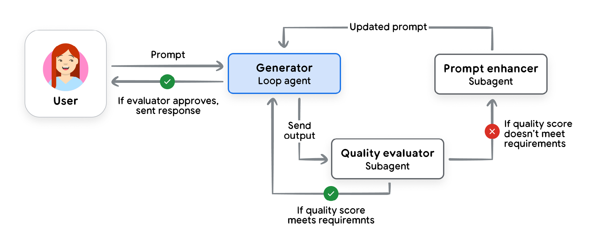

**图 3：**“iterative refinement（迭代优化）”模式，来源：https://cloud.google.com/architecture/choose-design-pattern-agentic-ai-system

对于更线性的工作流，**Sequential（顺序式）**模式更合适，它像一条数字流水线，前一个智能体的输出直接成为下一个智能体的输入。其他重要模式则聚焦质量与安全。**Iterative Refinement（迭代优化）**模式建立反馈回路：由“生成者”智能体创作内容，再由“评论者”智能体按质量标准评估。对于高风险任务，**HITL（人在回路中）**模式至关重要——它会在工作流中刻意暂停，等人工批准后，智能体才能执行重要动作。

## 智能体部署与服务

在本地搭好智能体之后，你会想把它部署到服务器上，让它持续运行，供其他人和智能体使用。沿用前面的比喻，部署与服务就是智能体的身体和双腿。要让智能体真正发挥作用，还需要若干服务：会话历史、记忆持久化等等。作为智能体构建者，你还要决定记录哪些日志、采取哪些安全措施来保护数据隐私、满足数据驻留和监管合规要求。把智能体部署到生产环境时，这些服务都在考虑范围内。

好在构建者可以依赖新推出的 **Gemini Enterprise Agent Platform**。它为技术团队提供了一站式平台，用来构建、扩展、治理和优化智能体。平台包含新的 **Agent Studio**，让从 prompt 到部署的过渡无缝衔接；还有焕然一新的 **Agent Runtime**，带来亚秒级冷启动、对**多日自主工作流**的支持，以及跨会话持久保存长期上下文的 **Memory Bank**——以及其他所有能力，都集中在同一个平台上²¹。对于希望更直接地掌控应用栈、或想把智能体部署进现有 DevOps 基础设施的软件开发者，任何智能体和大多数智能体服务都可以打包进 Docker 容器，部署到 Cloud Run 或 GKE²² 这类行业标准运行时上。

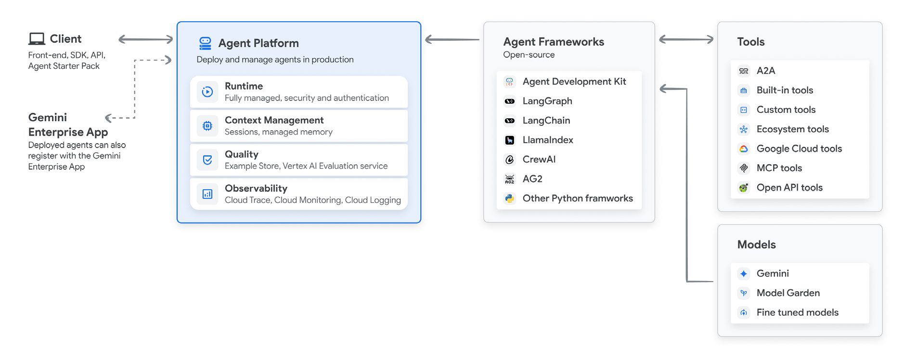

**图 4：**Gemini Enterprise Agent Platform，来源：https://cloud.google.com/products/gemini-enterprise-agent-platform

如果你既不是软件开发者，也不是 DevOps 专家，第一次部署智能体可能会让人发怵。许多智能体框架把这件事简化成一条 deploy 命令，或提供一个专用平台来部署，适合早期探索和上手。要升级到安全、可上生产的环境，通常需要投入更多时间，并落实最佳实践，包括为智能体搭建 CI/CD 和自动化测试²³。

## Agent Ops：以结构化方法应对不可预测性

构建第一批智能体时，你会一遍又一遍地手动测试它的行为。加了一个功能，它管用吗？修了一个 bug，会不会又引出别的问题？测试是软件开发的常规操作，但在生成式 AI 里，玩法不一样。

从传统、确定性的软件，转向随机性的智能体系统，需要一套新的运营哲学。传统软件单元测试只要断言 `output == expected` 就行；但智能体的响应天生带有概率性，这一招就不灵了。此外，语言本身很复杂，通常还得让 LM 来评估“质量”——看智能体的回答是否该做的都做了、不该做的都没做，而且语气恰当。

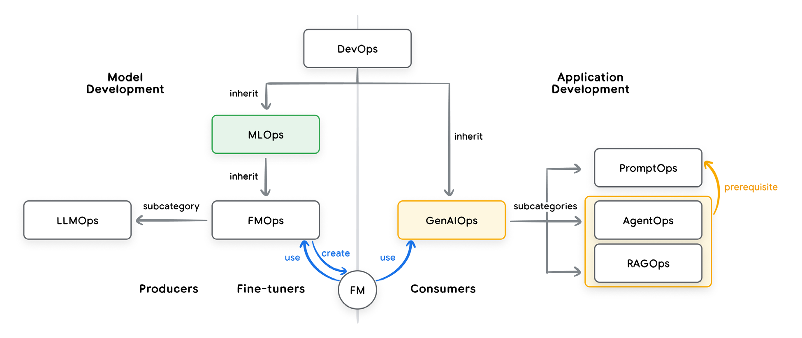

**图 5：**DevOps、MLOps 与 GenAIOps 三个运营领域之间的关系，来源：https://medium.com/@sokratis.kartakis/genai-in-production-mlops-or-genaiops-25691c9becd0

Agent Ops 就是用有纪律、结构化的方式来管理这种新现实。它是 DevOps 和 MLOps 的自然演进，针对 AI 智能体在构建、部署和治理上的独特挑战做了调整，把不可预测性从负担变成一种可管理、可度量、可靠的特质²⁴。更完整的深入讨论，请参阅本系列中专门讲智能体质量的白皮书。

### 衡量真正重要的指标：像 A/B 实验一样度量成功

在改进智能体之前，先要定义：在你的业务语境里，“更好”到底指什么。像设计 A/B 实验那样设计可观测性策略，问自己：哪些 KPI 能证明智能体正在创造价值？这些指标不能只看技术上的正确性，还要衡量真实世界的影响：目标完成率、用户满意度、任务延迟、每次交互的运营成本，以及最重要的——对收入、转化率、客户留存等业务目标的影响。这种自上而下的视角会指引后续测试，把你带上指标驱动开发的路，也让你能算出投资回报。

### 以质量评估取代通过/失败：使用 LM Judge

业务指标不会告诉你智能体行为是否正确。既然简单的通过/失败判定行不通，我们就改用“LM as Judge”（让 LM 当裁判）来评估质量。具体做法是：用一个强大的模型，按照预先定义的评分标准评估智能体的输出——答案对不对？内容有没有事实依据？有没有遵守指令？这种自动化评估跑在一套 golden dataset（黄金数据集）的 prompt 上，能提供一致的质量度量。

构建评估数据集——包含理想（“黄金”）问题和正确答案——可能是个枯燥的过程。要建立这样的数据集，应从智能体现有的生产或开发交互中抽取场景。数据集必须覆盖你预期用户会用到的全部用例，再加几个意料之外的场景。评估上的投入很快就会有回报，但评估结果在被认定为有效之前，始终应由领域专家审核。如今，评估集的策展与维护正逐渐成为产品经理的一项重要职责，领域专家则提供支持。为了让这项工作落地，Gemini Enterprise Agent Platform 提供了 **Agent Simulation** 和 **Agent Evaluation** 等专用工具，让团队在上线前自动打分、做压力测试并保障质量。

### 指标驱动开发：部署前的 Go/No-Go 决策

当你自动化了几十个评估场景、建立起可信的质量分数之后，就可以放心测试开发中智能体的改动了。流程很简单：让新版本跑完整个评估数据集，再把它与现有生产版本的分数直接对比。这套稳健的机制排除了猜测，让每次部署都有底气。自动化评估固然关键，但也别忽略延迟、成本和任务成功率等其他重要因素。为了最大程度保证安全，可以用 A/B 部署逐步放量，把真实生产指标和仿真分数放在一起比较。

### 借助 OpenTelemetry Trace 调试：回答“为什么？”

当指标下滑，或者用户报告 bug 时，你需要弄清“为什么”。OpenTelemetry trace 会高保真地、一步步记录智能体完整的执行路径（轨迹），让你可以调试智能体的每一步²⁵。借助 trace，你能看到发给模型的确切 prompt、模型的内部推理（如果可得）、它选择调用的具体工具、为工具生成的确切参数，以及作为观察结果返回的原始数据。第一次看 trace 可能会觉得复杂，但它提供了诊断和修复问题根因所需的细节。重要的 trace 细节可以转成指标，不过查看 trace 主要用于调试，而不是总览性能。Trace 数据可以无缝采集到 **Google Cloud Trace** 这类平台中，在那里可视化和检索海量 trace，简化根因分析。借助 Gemini Enterprise Agent Platform，开发者现在还能使用 **Agent Observability** 对完整推理链做可视化调试，并用 **Agent Optimizer** 自动聚类失败、自动建议 system prompt 的修改方案。

### 珍视人类反馈：为自动化指引方向

人类反馈不是什么需要打发的麻烦，而是你改进智能体时最有价值、数据最丰富的资源。用户提交 bug 报告，或点下“踩”的按钮，其实是在送你一份礼物：一个自动化评估场景没覆盖到的、真实世界的新边缘案例。收集并汇总这些数据至关重要；当你看到数量在统计上显著的相似报告或指标下滑时，必须把这些事件关联回分析平台，提炼洞察，并为运营问题触发告警。有效的 Agent Ops 流程会“闭环”：捕获反馈、复现问题，再把那个具体场景变成评估数据集里一条永久的新测试用例。这样不仅能修好这个 bug，还能让系统对整类错误产生“免疫力”，防止它们再次发生。

## 智能体互操作性

构建出高质量的智能体之后，你会希望把它们与用户和其他智能体连接起来。用身体部位的比喻来说，这一层相当于智能体的“脸”。连接智能体，和用数据、API 连接智能体，是两回事：智能体不是工具²⁶。假设你已经把工具接进了智能体，接下来要考虑的是，如何让智能体融入更大的生态。

### 智能体与人

智能体与人交互，最常见的方式是通过用户界面。最简单的形态是聊天机器人：用户输入请求，智能体作为后端服务处理，再返回一段文本。更高级的智能体能提供 JSON 这类结构化数据，支撑丰富、动态的前端体验。HITL（人在回路中）交互模式包括意图澄清、目标扩展、确认和澄清请求。

Computer use 是一类工具：由 LM 接管用户界面，通常仍有人类参与和监督。具备 computer use 能力的智能体可以判断，下一步最佳动作是跳转到新页面、高亮某个按钮，还是用相关信息预填表单²⁷。

除了让智能体代替用户操作界面，LM 还可以反过来改造 UI，以满足当下的需求。实现方式包括控制 UI 的工具（MCP UI）²⁸、能将客户端状态与智能体同步的专用 UI 消息系统（AG UI）²⁹，甚至直接生成定制界面（A2UI）³⁰。现在，Gemini Enterprise 应用通过 **Agent-to-UI 协议（A2UI）**原生支持这类动态交互，让自定义智能体能在用户的工作区内直接生成丰富的原生 UI 组件，比如交互式数据可视化和结构化表单。

当然，人机交互并不限于屏幕和键盘。高级智能体正在打破文本的界限，进入实时多模态交流；“live mode”则让连接更自然、更像人与人之间的对话。Gemini Live API³¹ 这类技术支持双向流式传输，用户可以对着智能体说话，也可以随时打断它，就像日常交谈一样。

这项能力从根本上改变了智能体与人类协作的性质。有了设备的摄像头和麦克风，智能体能看见用户所见、听见用户所说，并以接近人类对话的延迟用合成语音回应。这打开了大量纯文本根本无法实现的使用场景：维修技师在修理设备时获得免手操作指导，购物者实时获得穿搭建议。智能体由此成为一个更直观、更易接近的伙伴。

### 智能体与智能体

智能体不仅要与人连接，也要彼此连接。随着企业扩大 AI 的使用规模，不同团队会构建不同的专用智能体。如果没有统一标准，想把它们连起来，就得到处搭建脆弱、定制化的 API 集成，缠成一团乱麻，根本没法维护。核心挑战有两方面：发现（我的智能体怎么找到其他智能体，并知道它们能做什么？）和通信（怎么确保它们说同一种语言？）。

**A2A（Agent2Agent）协议**就是为解决这个问题而设计的开放标准。它相当于智能体经济中的通用握手方式。A2A 允许任何智能体发布一张数字“名片”，也就是 Agent Card。这个简单的 JSON 文件会声明智能体的能力、网络端点和交互所需的安全凭证，让发现变得简单、标准。与专注于处理事务性请求的 MCP 不同，智能体之间的通信通常是为了进一步协同解决问题。

发现彼此之后，智能体通过面向任务的架构通信。交互不再是简单的请求—响应，而是被组织成异步的“任务”。客户端智能体向服务端智能体发送任务请求，后者在一条长连接上处理问题，并持续提供流式更新。这套稳健、标准化的通信协议是拼图的最后一块，让协作式的 Level 3 多智能体系统成为可能，而它正代表着自动化的前沿。A2A 把一个个孤立的智能体，变成了真正可互操作的生态。

### 智能体与金钱

随着 AI 智能体替我们承担更多任务，其中一些会涉及买卖、谈判或促成交易。今天的网络是为人类点“购买”而建的，责任在人。如果换成自主智能体去点“购买”，就会引发信任危机——出了问题，算谁的？这涉及授权、真实性和问责等一系列复杂问题。要释放真正的智能体经济，我们需要新的标准，让智能体能安全、可靠地代表用户进行交易。

这个新兴领域远未定型，但有两个关键协议正在铺路。**AP2（Agent Payments Protocol）**是一个开放协议，目标是成为智能体商务的通用语言。它扩展了 A2A 等协议，引入经过密码学签名的数字“授权书”（mandates）。这些授权书是可验证的用户意图证明，为每笔交易留下不可否认的审计轨迹，让智能体能够基于用户的委托授权，在全球范围内安全地浏览、谈判和交易。与之互补的是 **x402**——一个开放的互联网支付协议，使用标准的 HTTP 402“Payment Required”状态码。它实现了无摩擦的机器对机器微支付，让智能体可以按使用量付费购买 API 访问或数字内容，无需复杂的账户或订阅。这两个协议合在一起，正在为智能体网络搭建基础的信任层。

## 保护单个智能体：信任的权衡

创建第一个 AI 智能体时，你会立刻遇到一个根本矛盾：效用与安全之间的权衡。要让智能体有用，就得给它权力——自主决策的权力，以及发邮件、查数据库之类采取行动的工具。可是，你给的每一分权力，都会带来相应的风险。最主要的安全顾虑是**失控行为**——非预期或有害的行为——以及**敏感数据泄露**。你想给智能体一根足够长的牵引绳，让它能干活；但又不能太长，免得它冲进车流，尤其是当车流涉及不可逆操作或公司私有数据的时候³²。

要管住它，你不能只靠 AI 模型自己的判断，因为它可能被 prompt injection（提示注入）之类的手法操纵³³。最佳实践是混合式、纵深防御的策略³⁴。第一层是**传统的确定性护栏**——一组硬编码规则，在模型推理之外形成安全关卡。比如，一个策略引擎可以拦截任何超过 100 美元的购买，或者在智能体调用外部 API 之前要求用户明确确认。这一层为智能体的权力设定了可预测、可审计的硬性上限。

第二层利用**基于推理的防御**，用 AI 来保护 AI。这包括训练模型增强抗攻击能力（对抗训练），以及部署更小、更专门的 guard model（守护模型）来做安全分析。这些模型可以在智能体的计划执行前先行审查，把潜在风险或违反策略的步骤标记出来，交由人工复核。这种混合模式把代码的刚性确定性与 AI 的上下文感知能力结合起来，即使只有一个智能体，也能建立起稳健的安全态势，确保它的权力始终与目的相匹配。

### 智能体身份：一类全新的主体

在传统安全模型中，人类用户使用 OAuth 或 SSO，服务则使用 IAM 或 service account（服务账号）。智能体增加了第三类主体（principal）。智能体不只是一段代码，它是一个自主行动者，一类需要自身可验证身份的新主体。就像员工会拿到工牌，平台上的每个智能体也必须获得一份安全、可验证的“数字护照”。这个 **Agent Identity** 既不同于调用它的用户身份，也不同于构建它的开发者身份。这意味着企业在处理身份与访问管理（IAM）时，思路必须发生根本转变。

每个身份都经过验证，并且对所有身份都实施访问控制，这是智能体安全的基石。一旦智能体拥有可通过密码学验证的身份（通常采用 SPIFFE 这类安全身份框架标准³⁵），就能被授予专属的最小权限。SalesAgent 可以获得 CRM 的读写权限，而 HRonboardingAgent 则被明确拒绝。这种细粒度控制至关重要：即使某个智能体被攻破或行为异常，潜在的爆炸半径也能被限制住。没有智能体身份机制，智能体就无法以有限的委托权限代表人类工作。Gemini Enterprise Agent Platform 现在通过 Agent Identity 功能原生落实这一点，确保每个智能体都获得唯一的密码学 ID，并形成清晰、可审计的轨迹，映射回企业既定的授权策略。

| 主体类型 | 认证 / 验证 | 说明 |
| --- | --- | --- |
| 用户 | 通过 OAuth 或 SSO 认证 | 完全自主、对自己的行为负责的人类行动者 |
| 智能体（新一类主体） | 通过 SPIFFE 验证 | 拥有委托授权，代表用户采取行动 |
| 服务账号 | 集成到 IAM | 应用与容器，完全确定性，不对行为负责 |

**表 1：**用于认证的不同类型行动者示例（非穷尽列表）

### 约束访问的策略

策略（policy）是一种授权（AuthZ），有别于认证（AuthN）。通常，策略限制的是主体的能力。例如：“市场部的用户只能访问这 27 个 API 端点，不能执行 DELETE 命令。”在开发智能体时，我们需要给智能体、它们的工具、其他内部智能体、可共享的上下文以及远程智能体分别配置权限。可以这样理解：如果你把 API、数据、工具和智能体统统接进系统，就必须把访问权限收窄到“完成工作所必需”的那个子集。推荐做法正是如此：在保持上下文相关性的同时，落实最小权限原则³⁶。

### 保护 ADK 智能体

身份和策略这两项核心原则确立之后，保护用 ADK（Agent Development Kit）构建的智能体，就成了一道实践题：如何通过代码和配置把这些概念落实下去³⁷。

如上所述，这个过程需要清晰定义各种身份：用户账号（例如 OAuth）、服务账号（用于运行代码）、智能体身份（用于行使委托授权）。认证处理完之后，下一层防御就是建立策略，约束对服务的访问。这通常在 API 治理层完成，同时也要治理支撑 MCP 和 A2A 的服务。

再下一层，是把护栏建进工具、模型和子智能体里，让策略真正生效。这样一来，无论 LM 推理出什么，或者恶意 prompt 暗示了什么，工具自身的逻辑都会拒绝执行不安全或违反策略的动作。这种方法提供了可预测、可审计的安全基线，把抽象的安全策略翻译成具体、可靠的代码³⁸。

如果需要更动态、能适应智能体运行时行为的安全机制，ADK 提供了 **Callback 和 Plugin**。`before_tool_callback` 让你能在工具调用真正执行前检查参数，对照智能体当前状态做验证，防止动作偏离目标。想要更可复用的策略，可以编写 plugin。一种常见模式是“Gemini as a Judge”³⁹：用一个快速、便宜的模型（比如 Gemini Flash-Lite，或你自己微调的 Gemma 模型）实时筛查用户输入和智能体输出，识别 prompt injection 或有害内容。

在 Gemini Enterprise Agent Platform 中，**Agent Gateway** 扮演整个生态的“空中交通管制”。它提供安全、统一的连接，同时原生执行 **Model Armor** 防护，抵御 prompt injection 和数据泄露。Model Armor 是一层专门的安全机制，会筛查 prompt 和响应中的各类威胁，包括 prompt injection、越狱（jailbreak）尝试、敏感数据（PII，个人身份信息）泄露和恶意 URL⁴⁰。把这些复杂的安全任务交给专用服务，开发者无需自行搭建和维护护栏，也能获得一致、稳健的防护。ADK 中的这种混合思路——强身份、工具内的确定性逻辑、动态 AI 护栏，加上可选的 Model Armor 等托管服务——正是打造既强大又可信的单个智能体的方法。

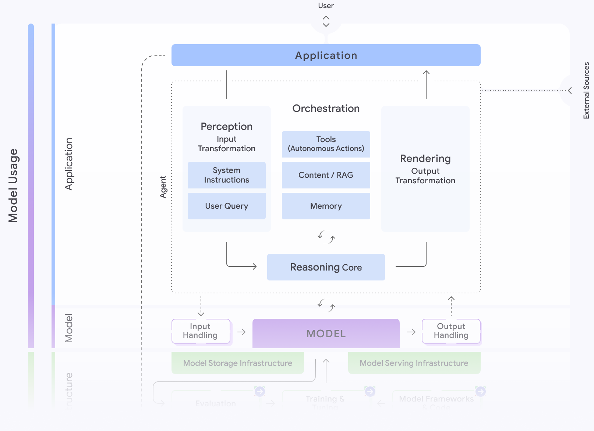

**图 6：**安全与智能体，来源：https://saif.google/focus-on-agents

## 从单个智能体扩展到企业级集群

一个 AI 智能体在生产环境跑通，是件值得庆祝的事；要扩展到成百上千个，就成了架构难题。只建一两个智能体时，你主要操心安全；建很多智能体时，系统设计就得应对更多问题。就像 API 泛滥一样，当智能体和工具在企业里四处蔓延，它们会形成一张全新而复杂的网络，包含大量交互、数据流和潜在安全漏洞。要管住这种复杂度，需要一个更高阶的治理层，把身份和策略统一起来，并汇总到一个中央控制平面。

### 安全与隐私：加固智能体前沿

企业级平台必须应对生成式 AI 固有的独特安全与隐私挑战，哪怕只运行一个智能体也不例外。智能体本身就成了新的攻击向量。恶意行为者可能用 **prompt injection** 劫持智能体的指令，或用 **data poisoning（数据投毒）**污染它用于训练或 RAG 的信息。此外，约束不当的智能体可能在回答中无意泄露敏感的客户数据或专有信息。

稳健的平台会用纵深防御策略来缓解这些风险。首先是数据：确保企业的专有信息绝不会被用于训练基础模型，并通过 VPC Service Controls（VPC 服务边界）之类的控制措施加以保护。其次是输入输出过滤，相当于给 prompt 和响应装一道防火墙。最后，平台还必须提供合同层面的保护，比如针对训练数据和生成输出的知识产权赔偿，让企业在法律和技术上都有信心把智能体投入生产。

### 智能体治理：用控制平面取代无序扩张

随着智能体及其工具在企业内不断扩散，它们会织出一张复杂的新网络，带来大量交互和潜在漏洞，这个问题常被称为“agent sprawl”（智能体泛滥）。要管好它，不能只停留在保护单个智能体，而要采用更高阶的架构思路：用一个中央网关，作为所有智能体活动的控制平面。

想象一座熙熙攘攘的大都市，成千上万辆自动驾驶车辆——用户、智能体和工具——各有目的地穿梭。如果没有红绿灯、车牌和中央控制系统，必然一片混乱。网关方案就是在建这套控制系统：为所有智能体流量设立统一入口，包括用户到智能体的 prompt 或 UI 交互、智能体到工具（经 MCP）的调用、智能体之间的协作（经 A2A），以及直接发往 LM 的推理请求。占据这个关键路口，企业就能检查、路由、监控和管理每一次交互。

这个控制平面承担两项相互关联的主要职能：

1. **运行时策略执行：**这个控制平面通过新的 **Agent Gateway** 落地，在任何环境中执行一致的安全策略。它是实施安全的架构咽喉点，负责认证（“我知道这个行动者是谁吗？”）和授权（“它有权限做这件事吗？”）。集中执行带来了可观测性的“单一视图”，为每笔事务生成统一的日志、指标和 trace，把原本各自为政、缠成一团的智能体和工作流，变成透明、可审计的系统。
2. **集中治理：**要有效执行策略，网关需要一个可信的事实来源。这由中央注册中心提供——相当于面向智能体和工具的企业应用商店。开发者可以在其中发现并复用现有资产，避免重复劳动；管理员则能获得完整清单。更重要的是，它能为智能体和工具建立正式的生命周期，支持发布前的安全审查、版本管理，以及制定细粒度策略，规定哪些业务单元可以访问哪些智能体。这些由新的 **Agent Registry** 管理：这是一个中央库，为每个内部智能体、工具和 **Skill** 建立索引（包括面向可编码工作流的可复用 **Skills**），简化发现过程，并确保只有经过批准的资产才可用。

把运行时网关与中央治理注册中心结合起来，企业就能把混乱蔓延的风险，转化为一个可管理、安全且高效的生态。

### 成本与可靠性：基础设施底座

归根结底，企业级智能体必须既可靠又划算。一个经常失败、响应缓慢的智能体，投资回报是负的；反过来，一个贵得离谱的智能体，也没法扩展到满足业务需求。底层基础设施的设计必须平衡这组取舍，同时保证安全，并符合监管与数据主权要求。

有些情况下，你需要的是 scale-to-zero（缩容到零）：当某个智能体或子功能的流量不规律时，它能自动缩到零。对于任务关键、延迟敏感的工作负载，平台必须提供专用、有保障的容量，比如 LM 服务的 Provisioned Throughput（预置吞吐量）⁴¹，或 Cloud Run 这类运行时的 99.9% SLA⁴²。这能带来可预测的性能，确保最重要的智能体即使在重负载下也能及时响应。提供这样一整套基础设施选项，再加上对成本和性能的全面监控，你就为 AI 智能体打下了最后一块必要底座——让它从一个有前景的创新，变成企业核心、可靠的组成部分。

## 智能体如何演化与学习

部署到真实世界的智能体，面对的是政策、技术和数据格式不断变化的动态环境。如果缺乏适应能力，智能体的表现会随时间推移而退化——这个过程常被称为“aging”（老化）——最终失去效用和信任。靠人工更新一大群智能体来跟上变化，既不经济，速度也慢。更具扩展性的方案，是设计能够自主学习和演化的智能体，让它们在实际工作中以最小的工程投入持续提升质量⁴³。

### 智能体如何学习与自我演化

和人类很像，智能体从经验和外部信号中学习。这个学习过程有几类信息作为燃料：

- **运行时经验：**智能体从会话日志、trace、记忆等运行时产物中学习，这些产物记录了成功、失败、工具交互和决策轨迹。关键在于，其中还包括 HITL（人在回路中）反馈——它提供权威的纠正和指导。
- **外部信号：**学习也由新的外部文档驱动，比如更新后的企业政策、公开的监管指南，或其他智能体的评审意见。

这些信息随后被用来优化智能体未来的行为。高级系统不会只对过去的交互做简单总结，而是会产出可泛化的产物来指导下一次任务。最成功的适应技术可分为两类：

- **增强 context engineering：**系统持续打磨 prompt、few-shot（少样本）示例，以及从记忆中检索的信息。通过为每个任务优化提供给 LM 的上下文，提高成功概率。
- **工具优化与创造：**智能体的推理能发现自身能力缺口，并采取行动补上。可以是接入新工具、即时创建一个新工具（例如一段 Python 脚本），或修改现有工具（例如更新 API schema）。

其他优化技术，例如动态重配多智能体设计模式、使用 RLHF（基于人类反馈的强化学习），仍是活跃的研究方向。

### 示例：学习新的合规准则

设想一个在金融或生命科学这类强监管行业运行的企业智能体。它的任务是生成报告，而这些报告必须符合隐私和监管规则（例如欧盟《通用数据保护条例》GDPR）。

这可以用一套多智能体工作流来实现：

1. **Querying Agent** 根据用户请求检索原始数据。
2. **Reporting Agent** 把这些数据综合成一份报告草稿。
3. **Critiquing Agent** 带着已知的合规准则审查报告。如果遇到模糊之处或需要最终签字，就上报给人类领域专家。
4. **Learning Agent** 观察整个交互过程，特别关注人类专家给出的纠正反馈，再把反馈泛化成一条新的、可复用的准则（例如给 Critiquing Agent 的新规则，或给 Reporting Agent 的更精细上下文）。

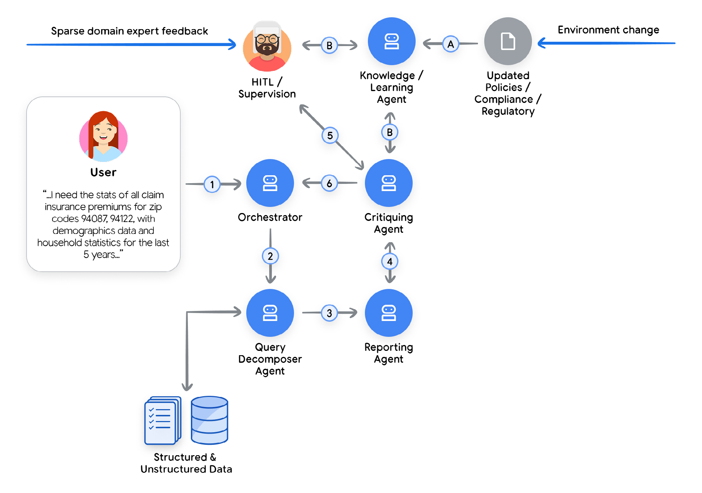

**图 7：**合规准则场景下的多智能体工作流示例

例如，如果人类专家指出某些家庭统计数据必须匿名化，Learning Agent 会记录这一纠正。下次生成类似报告时，Critiquing Agent 会自动应用这条新规则，减少人工介入。这个由评审、人类反馈和泛化构成的循环，让系统能够自主适应不断变化的合规要求⁴⁴。

### 仿真与 Agent Gym：下一个前沿

前面介绍的设计模式可以归为“in-line learning”（在执行路径内学习）：智能体必须用自己被设计时的那套资源和模式来学习。现在，研究者正在探索更先进的做法——搭建一个专用平台，在离线流程中利用更高级的工具和能力来优化多智能体系统，而这些工具和能力并不属于多智能体运行时的环境。这样一个 Agent Gym⁴⁵ 的关键特征包括：

1. 它不在执行路径上。它是一个独立的、脱离生产环境的平台，因此可以借助任意 LM、离线工具、云应用等等。
2. 它提供仿真环境，让智能体可以在新数据上“练兵”学习。这个仿真环境非常适合沿着多种优化路径做“试错”。
3. 它可以调用先进的合成数据生成器，让仿真尽可能贴近真实，并对智能体做压力测试（可以包括 red-teaming（红队测试）、动态评估和一组评审智能体等高级技术）。
4. 优化工具的“武器库”不是固定的，它可以接入新工具（通过 MCP 或 A2A 这类开放协议），或者在更高级的设定下学习新概念，并围绕这些概念打造工具。
5. 最后，即便是 Agent Gym 这样的构造，也可能搞不定某些边缘情况（原因在于企业中众所周知的“tribal knowledge”（部落知识）问题）。遇到这种情况，Agent Gym 可以接入由领域专家构成的人际网络，向他们咨询什么才是正确的结果，以指导下一轮优化。

## 高级智能体案例

### Google Co-Scientist

Co-Scientist 是一款高级 AI 智能体，定位是虚拟科研合作者。它通过系统性地探索复杂问题空间，加速科学发现。研究人员可以定义目标，让智能体扎根于指定的公开和专有知识源，然后生成并评估一片由新假设构成的图景。

为了实现这一点，Co-Scientist 会孕育出一整个相互协作的智能体生态。

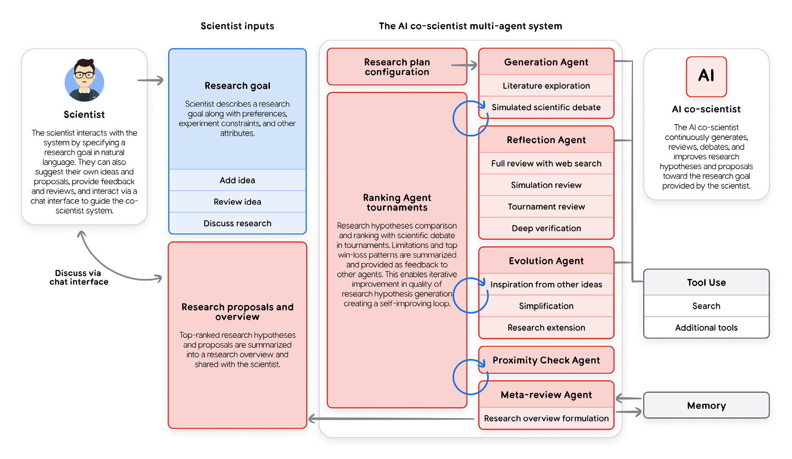

**图 8：**AI co-scientist 的设计体系

把这个系统想成一位科研项目经理。AI 先拿到一个宽泛的研究目标，制定详细的项目计划；然后由一个“Supervisor”智能体担任经理，把任务分派给专业智能体团队，并分配算力等资源。这样的结构保证项目可以轻松扩展，团队的工作方法也会在迈向最终目标的过程中不断改进。

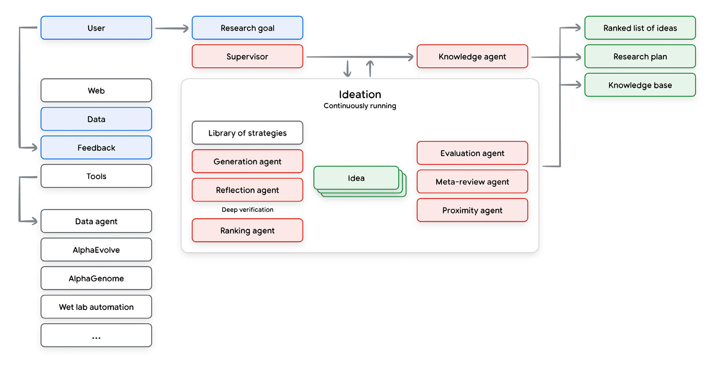

**图 9：**Co-scientist 多智能体工作流

各个智能体会工作数小时甚至数天，不断改进生成的假设，运行一层层循环和元循环——这些循环不仅改进生成的想法，也改进我们评判和创造新想法的方式。

### AlphaEvolve 智能体

另一个高级智能体系统的例子是 AlphaEvolve。它是一款 AI 智能体，专门为数学和计算机科学中的复杂问题发现并优化算法。

AlphaEvolve 的思路，是把 Gemini 语言模型富有创造力的代码生成能力，与自动化评估系统结合起来。它采用演化式流程：AI 生成候选解法，评估器打分，最有希望的思路再被用作下一代代码的灵感。

这种方法已经带来了若干重大突破，包括：

- 提升 Google 数据中心、芯片设计和 AI 训练的效率。
- 发现更快的矩阵乘法算法。
- 为未解决的数学问题找到新解法。

AlphaEvolve 擅长解决这样一类问题：验证一个解的质量，远比一开始找到它容易⁴⁶。

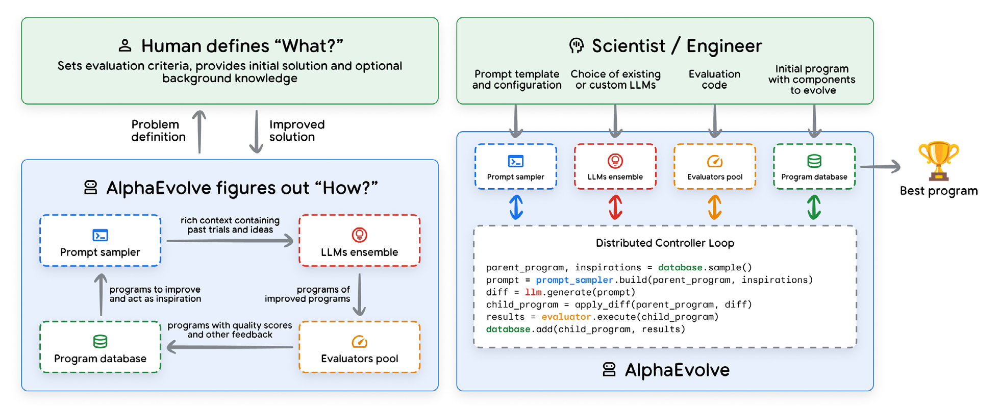

**图 10：**Alpha Evolve 的设计体系

AlphaEvolve 的设计初衷，是让人与 AI 建立深度、迭代式的伙伴关系。这种协作主要体现在两个方面：

- **透明的解决方案：**AI 以人类可读的代码形式生成解法。这种透明度让用户能理解逻辑、获得洞见、信任结果，并根据自己的需要直接修改代码。
- **专家引导：**人类专业知识在定义问题时不可或缺。用户通过改进评估指标、引导探索方向来指导 AI，防止系统钻问题定义里的空子。这个交互循环确保最终解法既强大又实用。

智能体产出的结果，是代码的持续改进——不断优化人类指定的指标。

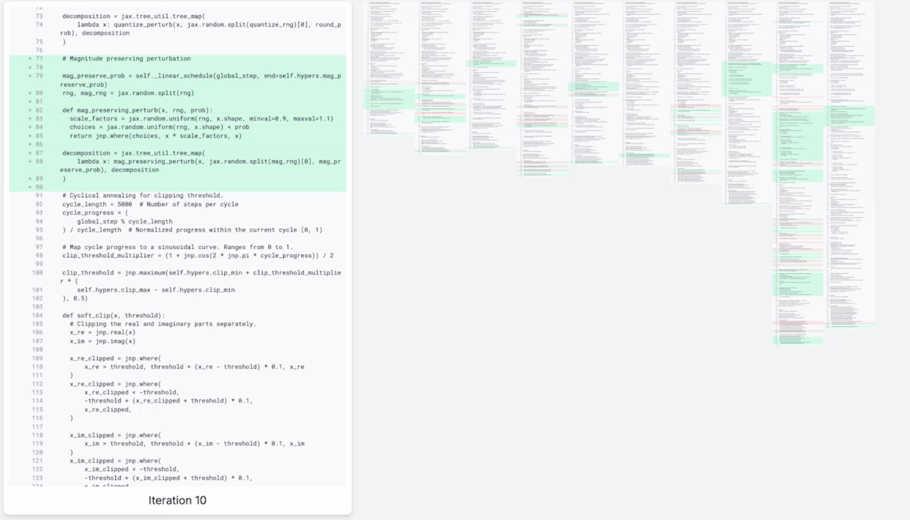

**图 11：**算法演化

## 结语

生成式 AI 智能体标志着一个关键演进：人工智能从被动的内容创作工具，转变为主动、自主的问题求解伙伴。本文提供了一套正式框架，帮助你理解和构建这类系统——不止于原型，而是建立起可靠、生产级的架构。

我们把智能体拆解为三个基本组件：负责推理的**模型**（“大脑”）、可执行操作的**工具**（“双手”），以及负责统筹的**编排层**（“神经系统”）。正是这些部分的无缝集成，以及它们在“思考、行动、观察”循环中的持续运转，释放出智能体真正的潜力。通过给智能体系统分类——从 Level 1 的连接外部工具的问题解决者，到 Level 3 的协作式多智能体系统——架构师和产品负责人现在可以有策略地界定目标，让雄心与手头任务的复杂度相匹配。

核心挑战，也是核心机会，在于一种新的开发者范式。我们不再只是定义显式逻辑的“泥瓦匠”，而是“架构师”和“导演”，必须引导、约束并调试一个自主实体。让 LM 如此强大的灵活性，也正是它们不可靠的根源。因此，成功不能只靠最初那句 prompt，而要靠施加于整个系统的工程严谨性：稳健的工具契约、健壮的错误处理、精细的上下文管理，以及全面的评估。

本文概述的原则和架构模式，构成了一份基础蓝图，也是在这片软件新前沿中导航的路标。它们让我们能够构建的不只是“工作流自动化”，而是真正善于协作、能力出众、适应力强的新团队成员。随着这项技术走向成熟，这种有纪律、重架构的方法，将成为充分释放智能体 AI 力量的决定性因素。

## 尾注

1. Julia Wiesinger, Patrick Marlow, et al. 2024 “Agents”. Available at: https://www.kaggle.com/whitepaper-agents.
2. Antonio Gulli, Lavi Nigam, et al. 2025 “Agents Companion”. Available at: https://www.kaggle.com/whitepaper-agent-companion.
3. Shunyu Yao, Y. et al., 2022, 'ReAct: Synergizing Reasoning and Acting in Language Models'. Available at: https://arxiv.org/abs/2210.03629.
4. Wei, J., Wang, X. et al., 2023, 'Chain-of-Thought Prompting Elicits Reasoning in Large Language Models'. Available at: https://arxiv.org/pdf/2201.11903.pdf.
5. Shunyu Yao, Y. et al., 2022, 'ReAct: Synergizing Reasoning and Acting in Language Models'. Available at: https://arxiv.org/abs/2210.03629.
6. https://www.amazon.com/Agentic-Design-Patterns-Hands-Intelligent/dp/3032014018
7. Shunyu Yao, et. al., 2024, 'τ-bench: A Benchmark for Tool-Agent-User Interaction in Real-World Domains', Available at: https://arxiv.org/abs/2406.12045.
8. https://artificialanalysis.ai/guide
9. https://cloud.google.com/vertex-ai/generative-ai/docs/model-reference/vertex-ai-model-optimizer
10. https://gemini.google/overview/gemini-live/
11. https://cloud.google.com/vision?e=48754805&hl=en
12. https://cloud.google.com/speech-to-text?e=48754805&hl=en
13. https://medium.com/google-cloud/genaiops-operationalize-generative-ai-a-practical-guide-d5bedaa59d78
14. https://cloud.google.com/vertex-ai/generative-ai/docs/agent-engine/code-execution/overview
15. https://ai.google.dev/gemini-api/docs/function-calling
16. https://github.com/modelcontextprotocol/
17. https://ai.google.dev/gemini-api/docs/google-search
18. https://google.github.io/adk-docs/
19. https://google.github.io/adk-docs/sessions/memory/
20. https://cloud.google.com/architecture/choose-design-pattern-agentic-ai-system
21. https://cloud.google.com/vertex-ai/generative-ai/docs/agent-engine/overview
22. https://cloud.google.com/kubernetes-engine/docs/concepts/gke-and-cloud-run
23. https://github.com/GoogleCloudPlatform/agent-starter-pack
24. Sokratis Kartakis, 2024, 'GenAI in Production: MLOps or GenAIOps?'. Available at: https://medium.com/google-cloud/genai-in-production-mlops-or-genaiops-25691c9becd0.
25. Guangya Liu, Sujay Solomon, March 2025 “AI Agent Observability - Evolving Standards and Best Practice”. Available at: https://opentelemetry.io/blog/2025/ai-agent-observability/.
26. https://discuss.google.dev/t/agents-are-not-tools/192812
27. Damien Masson et. al, 2024, 'DirectGPT: A Direct Manipulation Interface to Interact with Large Language Models'. Available at: https://arxiv.org/abs/2310.03691.
28. MCP UI is a system of controlling UI via MCP tools https://mcpui.dev/.
29. AG UI is a protocol of controlling UI via event passing and optionally shared state https://ag-ui.com/.
30. A2UI is a protocol of generating UI via structured output and A2A message passing https://github.com/google/A2UI.
31. https://cloud.google.com/vertex-ai/generative-ai/docs/models/gemini/2-5-flash-live-api.
32. https://saif.google/focus-on-agents.
33. https://simonwillison.net/series/prompt-injection/.
34. https://storage.googleapis.com/gweb-research2023-media/pubtools/1018686.pdf.
35. https://spiffe.io/.
36. https://openreview.net/pdf?id=l9rATNBB8Y.
37. https://google.github.io/adk-docs/safety/.
38. https://google.github.io/adk-docs/callbacks/design-patterns-and-best-practices/#guardrails-policy-enforcement
39. TKTK
40. https://cloud.google.com/security-command-center/docs/model-armor-overview
41. https://cloud.google.com/vertex-ai/generative-ai/docs/provisioned-throughput/overview
42. https://cloud.google.com/run/sla
43. https://github.com/CharlesQ9/Self-Evolving-Agents
44. Juraj Gottweis, et. al., 2025, ‘Accelerating scientific breakthroughs with an AI co-scientist’. Available at: https://research.google/blog/accelerating-scientific-breakthroughs-with-an-ai-co-scientist/.
45. Deepak Nathani et. al. 2025, ‘MLGym: A New Framework and Benchmark for Advancing AI Research Agents’, Available at: https://arxiv.org/abs/2502.14499.
46. https://deepmind.google/blog/alphaevolve-impact/
